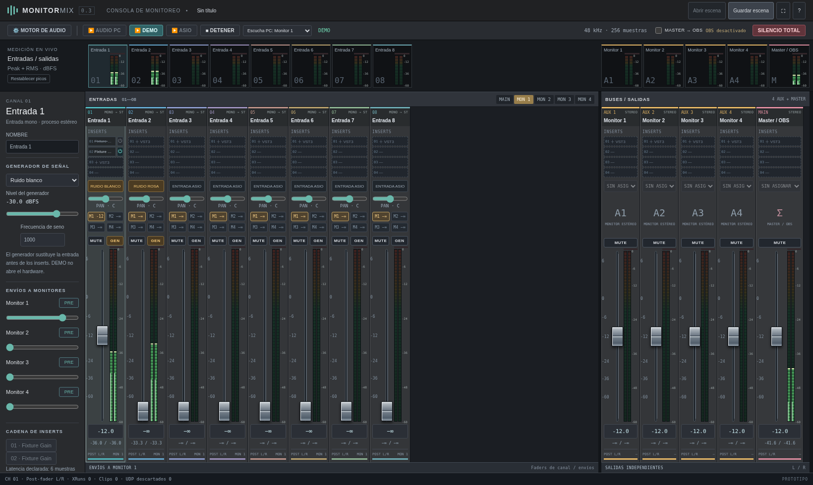

# Monitor Mix

Miniapp Windows x64 para mezclar entradas ASIO o probar generadores por la
salida normal del PC, crear cuatro monitores y enviar el master a OBS.

**Prueba local:** [descargar Windows x64](dist/MonitorMix-0.3.0-Windows-x64.zip)
e [instrucciones para Windows](docs/probar-en-windows.md).
La descarga incluye el ejecutable, el receptor de OBS y el código fuente.
Su checksum está en [SHA-256](dist/MonitorMix-0.3.0-Windows-x64.zip.sha256).

## Funciones actuales

- Ocho canales mono, procesados como estéreo; master y cuatro auxiliares.
- Faders compactos con marcas alineadas y entrada numérica exacta; envíos pre/post, panorama y mute.
- Pares de salidas físicas independientes y stream dúplex RtAudio/ASIO.
- Cuatro inserts VST3 visibles por canal, auxiliar y master, con bypass en vivo.
- Lista de VST3 instalados en carpetas estándar de Windows, con búsqueda y carpeta adicional.
- Consola estilo DAW, puente y medidores estéreo Peak/RMS por canal y bus.
- Ruido blanco, rosa y seno independientes por canal, antes de los inserts.
- AUDIO PC por WASAPI: escucha master o monitores sin ASIO ni MOTU.
- Modo DEMO sin dispositivo, medidores, silencio total y ajustes JSON.
- Puente de master por UDP local y receptor para OBS x64 32.1 o posterior.
- Instalador OBS corregido a ProgramData, diagnóstico y confirmación de recepción.

La miniapp reutiliza **los crates DSP y VST3 de SoundCraft de Artcraft**,
fijados a una revisión concreta. La interfaz y el ruteo son propios; no es
un fork de todo el DAW. No requiere controlar CueMix ni instalar REAPER.

Para probar sin hardware: **AUDIO PC → GEN en un canal → Escucha PC**.
DEMO procesa sin reproducir. Las escenas 0.1 siguen siendo compatibles.

## Ejecutar y compilar

El ZIP Windows incluye el ejecutable, el receptor OBS, guía y fuente. No
necesita compilador para probarlo. Arranca detenido, sin salidas asignadas.

Código de la app: `desktop/`. Para compilar localmente en Windows con Rust
1.95 y Visual Studio C++ Build Tools, ejecuta `desktop/build-windows.ps1`.
El Cargo.lock se conserva; usar siempre `--locked`.

En esta máquina Linux, `bash tools/setup-cloud.sh` prepara las dependencias
en `/workspace` y verifica el motor y la compilación cruzada. La UI se inicia
con `desktop/target/debug/monitor-mix --no-browser` y la consola imprime su
dirección local. El modo DEMO no abre hardware. Cierra el proceso al acabar.

## Validación y límites

Se verificaron ruteo y mute, procesamiento con un binario VST3 de prueba,
la UI en Chromium y audio real desde DEMO hasta callbacks de libobs en Linux.
Los binarios de Windows se compilaron y se inspeccionaron sus dependencias;
**no se ejecutaron nativamente en Windows ni se probaron con la MOTU**.

Es un prototipo: no hay compensación de latencia, editor nativo VST3 ni
estado binario de presets; se admiten cuatro inserts por tira. Faltan las pruebas
de ASIO real, compatibilidad de efectos, sincronía con video y sesiones largas.
La guía detalla estas limitaciones y la prueba paso a paso.

En 0.3 se corrigió la ruta del receptor: ejecuta el nuevo instalador como
administrador con OBS cerrado. OBS 32.2.2 x64 es compatible. Consulta
[el puente y la alternativa ReaStream](docs/puente-obs.md).

## Componentes anteriores

`include/`, `src/` y las pruebas CMake son el primer motor C++ portable.
Se conservan, pero no son el motor de la miniapp Rust actual. `tools/cuemix_osc.py`
y los documentos de CueMix conservan investigación anterior; no son necesarios
para esta app. No hay una integración de control de CueMix activa.

Licencias y procedencia: [desktop/THIRD_PARTY.md](desktop/THIRD_PARTY.md).
