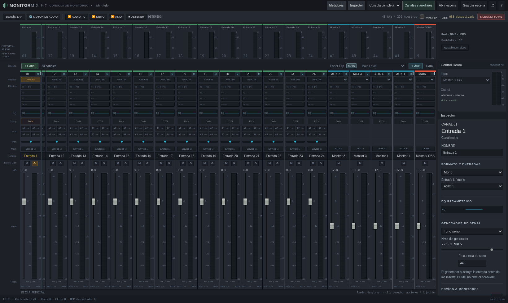

# Monitor Mix

Miniapp Windows x64 para mezclar entradas ASIO o probar generadores por la
salida normal del PC, crear mezclas auxiliares y enviar el master a OBS.

**Prueba local:** [descargar Windows x64](dist/MonitorMix-0.7.0-Windows-x64.zip)
e [instrucciones para Windows](docs/probar-en-windows.md).
La descarga incluye el ejecutable, el receptor de OBS y el código fuente.
Su checksum está en [SHA-256](dist/MonitorMix-0.7.0-Windows-x64.zip.sha256).

## Funciones actuales

- Compresor nativo por canal, aux y master: curva, perillas, reducción de ganancia real y sidechain externo.
- Superficie centrada con pocos canales; desplazamiento horizontal y tiras fijables a izquierda/derecha.
- Menú contextual propio sobre las tiras y selección de texto reservada a campos editables.
- **Escucha LAN** en otro puerto: cada navegador elige main o un aux; hasta ocho oyentes de referencia.

- De 1 a 64 canales y de 0 a 32 auxiliares: botones **+ Canal / + Aux** sobre sus bancos y panel **Canales y auxiliares**, también con audio activo.
- Canales y auxiliares mono/estéreo conmutables en vivo; los nuevos aux son mono.
- Entradas físicas L/R independientes del número de tiras. Trabajo a 48 kHz.
- Faders compactos con marcas alineadas y entrada numérica exacta; envíos pre/post, panorama y mute.
- Salidas físicas mono o pares estéreo independientes y stream dúplex RtAudio/ASIO.
- EQ paramétrico nativo por canal, auxiliar y master: ocho bandas FreeEQ8, seis tipos, fase mínima.
- EQ con curva interactiva, ocho puntos de color y perillas de frecuencia, ganancia y Q.
- Cadena FX con lista lateral, selección, agregar, quitar con Supr y reordenar; cuatro inserts por tira.
- FreeVox8 y MDA con perillas; VST3 con editor genérico de deslizadores y valores.
- Parámetros nativos y bypass editables en vivo; presets de usuario persistentes, importación/exportación JSON.
- Ventana **Envíos ↗** por canal: master, pan y envíos PRE/POST con controles gráficos.
- FreeVox8 (vocoder filterbank) y los 20 efectos de audio MDA integrados.
- Lista de VST3 instalados en carpetas estándar de Windows, con búsqueda y carpeta adicional.
- Consola compacta basada en las referencias Fairlight: módulos alineados, faders largos y colores por tipo.
- Fader Flip Main/Aux dinámico, botón MAIN y doble clic en pan para centrar, vista completa/reducida y paneles de medidores/inspector ocultables.
- Control Room para escucha PC de un bus, con medidor estéreo propio.
- Ruido blanco, rosa y seno independientes por canal, antes de los inserts.
- AUDIO PC por WASAPI: escucha master o monitores sin ASIO ni MOTU.
- Modo DEMO sin dispositivo, medidores, silencio total reversible y ajustes JSON.
- Puente de master por UDP local y receptor para OBS x64 32.1 o posterior.
- Instalador OBS corregido a ProgramData, diagnóstico y confirmación de recepción.

La miniapp reutiliza **los crates DSP y VST3 de SoundCraft de Artcraft**,
fijados a una revisión concreta. La interfaz y el ruteo son propios; no es
un fork de todo el DAW. No requiere controlar CueMix ni instalar REAPER.

Para probar sin hardware: **AUDIO PC → G en un canal → Control Room → Input**.
DEMO procesa sin reproducir. Las escenas 0.1 siguen siendo compatibles.

## Ejecutar y compilar

El ZIP Windows incluye el ejecutable, el receptor OBS, guía y fuente. No
necesita compilador para probarlo. Arranca detenido, sin salidas asignadas.

Código de la app: `desktop/`. Para compilar localmente en Windows con Rust
1.95 y Visual Studio C++ Build Tools, ejecuta `desktop/build-windows.ps1`.
El Cargo.lock se conserva; usar siempre `--locked`.

En esta máquina Linux, `bash tools/setup-cloud.sh` prepara las dependencias
en `/workspace` y verifica el motor y la compilación cruzada. La UI se inicia
con `desktop/target/debug/monitor-mix --no-browser` y la consola imprime su
dirección local. El modo DEMO no abre hardware. Cierra el proceso al acabar.

## Validación y límites

Se verificaron ruteo y mute, procesamiento con un binario VST3 de prueba,
la UI en Chromium y audio real desde DEMO hasta callbacks de libobs en Linux.
Los binarios de Windows se compilaron y se inspeccionaron sus dependencias;
**no se ejecutaron nativamente en Windows ni se probaron con la MOTU**.

El cambio de estructura se prepara fuera del callback de audio y se adopta al
terminar un bloque. Conserva los inserts existentes y devuelve la memoria al
hilo de control; no reabre el dispositivo. Las salidas ASIO disponibles se
abren al inicio. Cambiar dispositivo, entradas físicas abiertas o buffer exige
detener el motor. Agregar, quitar, reordenar o editar parámetros VST3 exige
detenerlo; parámetros nativos, EQ, bypass, niveles, envíos, formatos y cantidad
de tiras funcionan en vivo. Los presets de usuario se guardan en
`%LOCALAPPDATA%\MonitorMix\presets.json` en Windows.

Es un prototipo: no hay compensación de latencia, editor nativo VST3 ni
estado binario de presets; se admiten cuatro inserts por tira. Faltan las pruebas
de ASIO real, compatibilidad de efectos, sincronía con video y sesiones largas.
La guía detalla estas limitaciones y la prueba paso a paso.

En 0.3 se corrigió la ruta del receptor: ejecuta el nuevo instalador como
administrador con OBS cerrado. OBS 32.2.2 x64 es compatible. Consulta
[el puente y la alternativa ReaStream](docs/puente-obs.md).

## Control remoto previsto

[Dirección OSC, Mackie Control y Mackie HUI](docs/control-remoto.md): se prevé
un modo controlador sin abrir audio, además del mezclador independiente.
Estos protocolos y el mapa específico MOTU quedan para la siguiente etapa;
no se implementan en 0.7.

## Componentes anteriores

`include/`, `src/` y las pruebas CMake son el primer motor C++ portable.
Se conservan, pero no son el motor de la miniapp Rust actual. `tools/cuemix_osc.py`
y los documentos de CueMix conservan investigación anterior; no son necesarios
para esta app. No hay una integración de control de CueMix activa.

Licencias y procedencia: [desktop/THIRD_PARTY.md](desktop/THIRD_PARTY.md).

La integración nativa usa el núcleo de fase mínima de FreeEQ8 y el motor
filterbank de FreeVox8; no incorpora todas las funciones de esos plugins.
MDA incluye sus 20 efectos de audio; sus cuatro instrumentos MIDI quedan
pendientes. La grabación multipista y OSC/Mackie también quedan pendientes.
La aplicación combinada desde 0.5 se distribuye bajo GPL-3.0-only, con fuentes,
licencias y procedencia en el ZIP.

[Novedades y guía visual 0.7](docs/interfaz-0.7.md).

[Hoja de ruta](docs/hoja-de-ruta.md): otros dispositivos y subsistemas Windows,
mezclas personales desde la web, grabación multipista y control OSC/Mackie.
