# AuMux · galería de capturas

Capturas reales de **AuMux 0.13.0**, ejecutado en **DEMO a 48 kHz** con ocho
canales, cuatro auxiliares y master. Los generadores internos producen la señal
que muestran los medidores; no se conectó hardware ASIO. Las vistas se capturaron
en Chromium sobre Linux.

Esta galería muestra las funciones actuales. El modo de control de consolas
digitales X32/M32 y las demás familias comentadas sigue pendiente de implementación.

[Descargar para Windows](../dist/AuMux-0.13.1-Windows-x64.zip) ·
[Guía de prueba](probar-en-windows.md) · [Volver al README](../README.md)

## Ventanas independientes 0.13.1

La consola puede seguir ajustándose mientras EQ, plugins o preferencias están
en otras ventanas. [Guía de ventanas](interfaz-0.13.1.md).

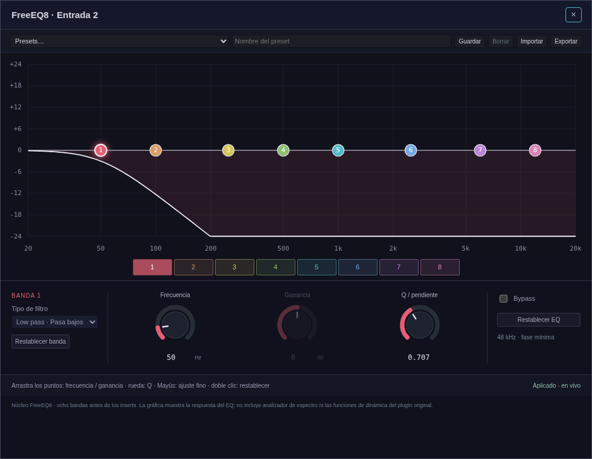

## Herramientas de señal 0.13

Detector de posibles acoples con cortes manuales en el EQ y osciloscopio de
señales reales de DEMO. [Alcance de las herramientas de medición](interfaz-0.13.md).

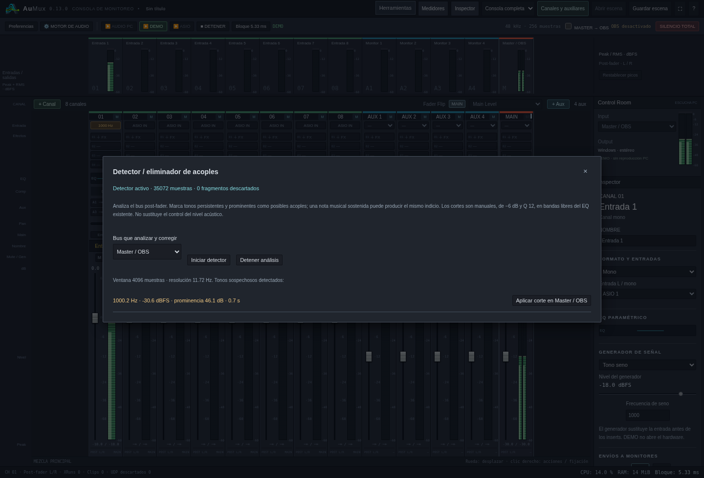

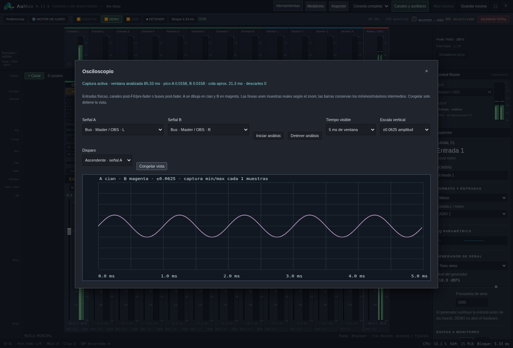

## Envíos UDP de AuMux Audio

Selección de bus, identificador y destinos IP/MagicDNS o broadcast local.
La captura muestra un auxiliar enviando audio real en loopback.


## Editor del receptor OBS

Editor con estilo AuMux, selección de flujo, búfer y delay por fuente,
medidores y diagnóstico. Esta captura corresponde al editor Qt6 probado en
Linux; el paquete Windows utiliza su editor Win32.


## Consola de escritorio

Canales mono/estéreo, auxiliares, master, puente de medidores, inserts por canal
e inspector. La escena usa nombres de ejemplo para identificar las rutas.

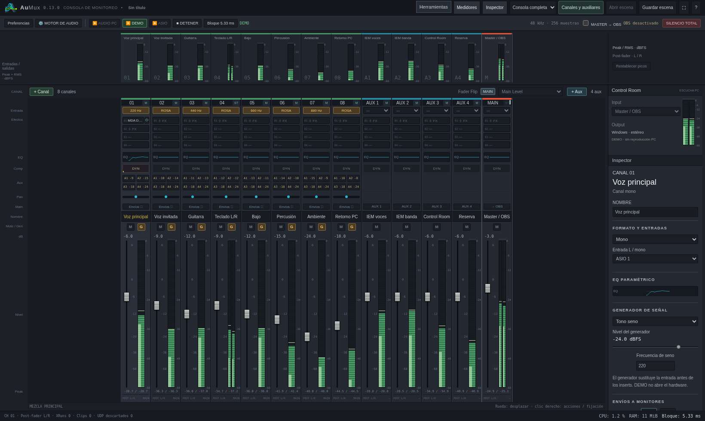

## EQ paramétrico

FreeEQ8 nativo con ocho bandas, curva interactiva y perillas. El ejemplo combina
un filtro de graves, un recorte en 250 Hz y un realce en 2,5 kHz.

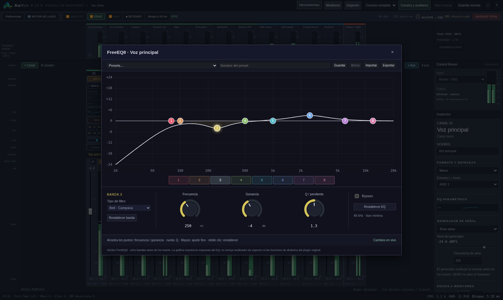

## Compresor y sidechain

Curva de compresión, reducción de ganancia y controles de dinámica. En esta
captura el detector recibe la señal del canal **Voz invitada**.

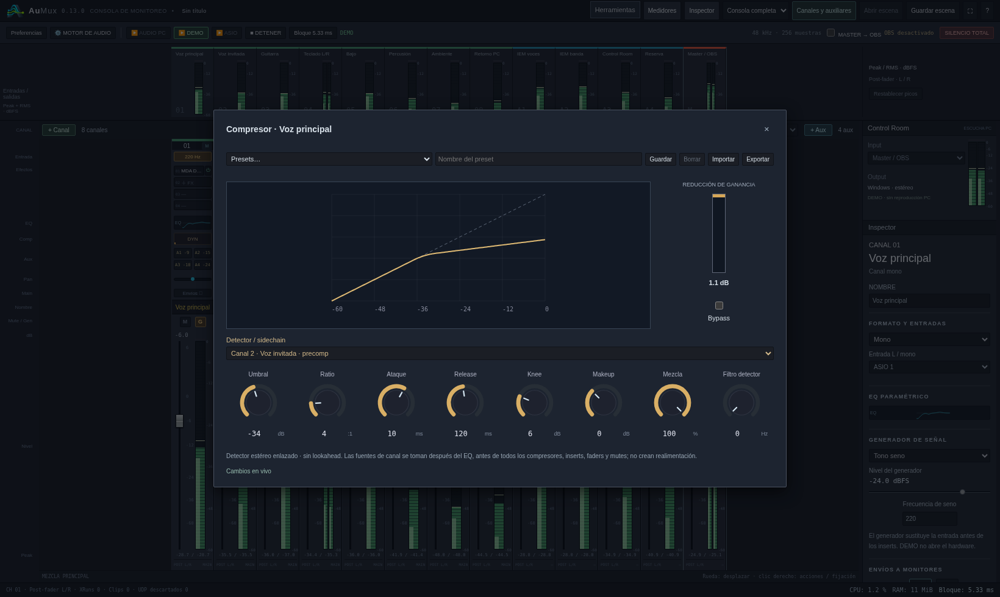

## Cadena de efectos

Lista de inserts a la izquierda y editor del efecto seleccionado a la derecha.
Se muestra el efecto nativo **MDA Dynamics** con sus perillas y opciones de presets.

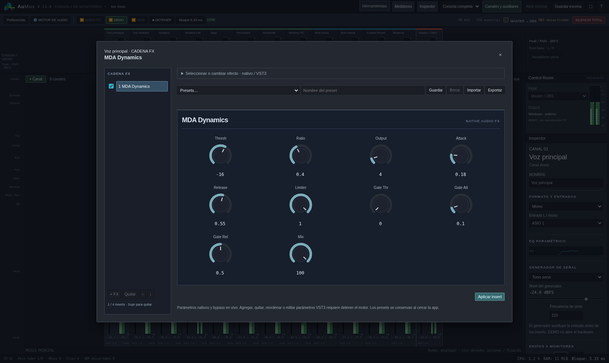

## Envíos de un canal

Nivel hacia el master, paneo y envíos auxiliares con nivel, mute y selección
PRE/POST. Los auxiliares conservan sus nombres en toda la interfaz.

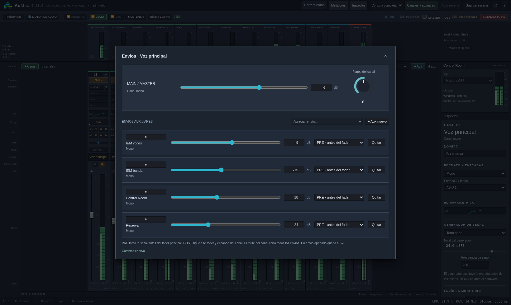

## Preferencias de redes

Selección de interfaz o dirección para compartir y puertos independientes de
control y escucha. Las capturas usan direcciones de loopback para la sesión de
demostración; no son enlaces para conectarse desde otro equipo.

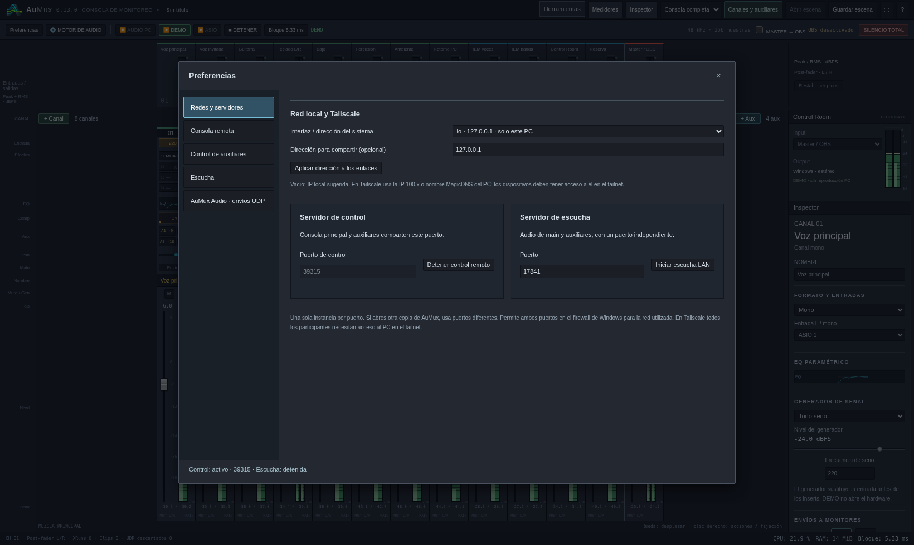

## Preferencias de auxiliares remotos

Enlace genérico con selector de mezcla o enlaces personales limitados a un
auxiliar, con permisos y nivel máximo por envío.

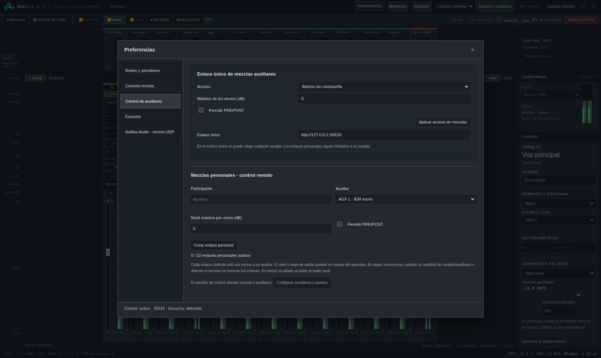

## Consola remota en modo touch

Vista de tablet de **1100 × 820**. Touch se activa manualmente desde Herramientas.
Los faders se arrastran por la perilla; el recorrido permite desplazarse entre
canales sin cambiar niveles accidentalmente.

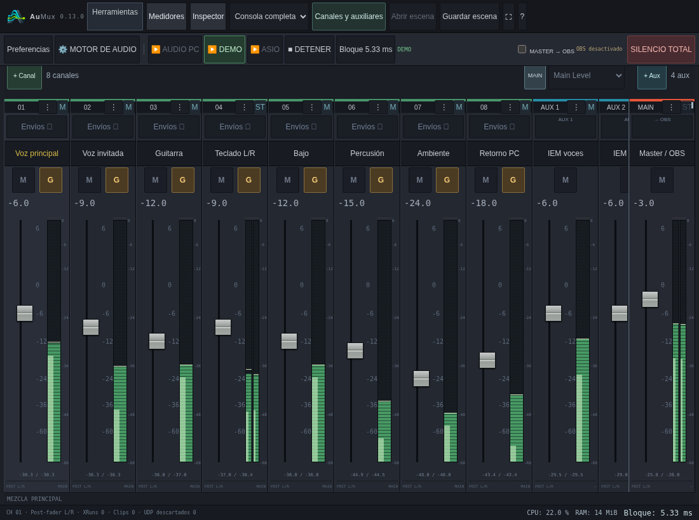

## Mezcla auxiliar desde el celular

Vista de **390 × 844** con el auxiliar **IEM voces** seleccionado. Cada fader
controla un envío hacia esa mezcla; los demás canales se alcanzan desplazándose
hacia los lados. El indicador confirma la conexión WebSocket.

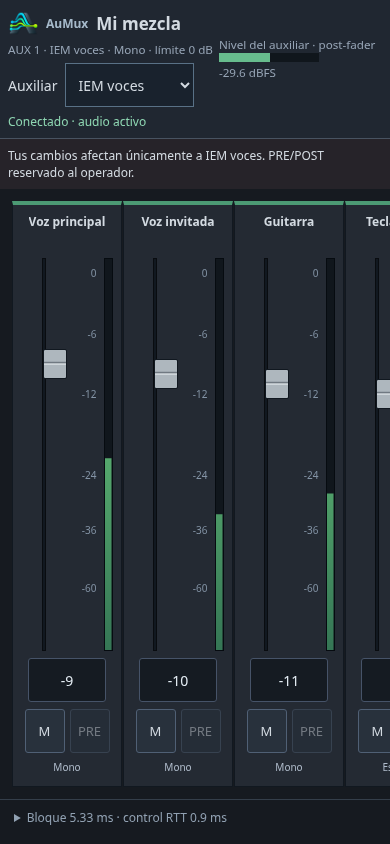

## Escucha desde el celular

Selección de mezcla, volumen local y objetivo de búfer del navegador. La sección
de latencia distingue los datos calculados o declarados de las mediciones de
control y de la latencia física todavía no medida. Se captura la página completa.

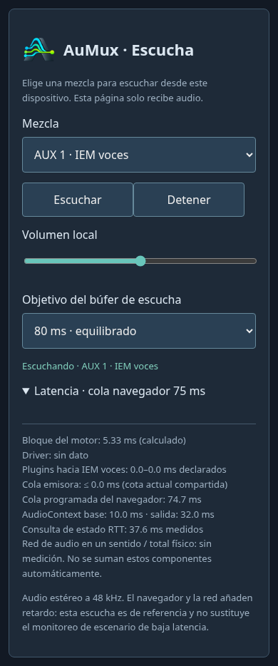

## Diagnóstico de latencia

Detalle por ruta del tamaño de bloque, plugins, colas y RTT de control. Los
valores de esta sesión DEMO no son resultados de latencia de una interfaz ASIO.

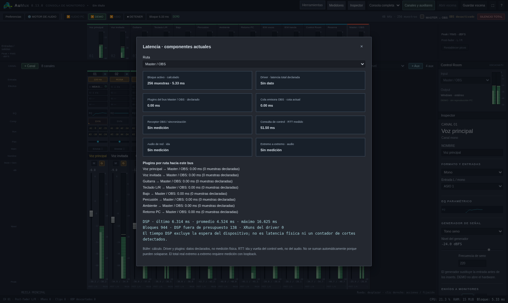

## Regenerar las capturas

Con el entorno de desarrollo preparado y el ejecutable de depuración compilado
desde la versión actual, ejecutar desde la raíz del repositorio:

```bash
NODE_PATH=/workspace/scratch/monitor-ui/node_modules node tools/capture-screenshots.cjs
```

El script usa Playwright Core y Chromium, crea una escena aislada, comprueba la
versión y el estado de las pantallas, y guarda los PNG en
`docs/screenshots/<versión>/`. Cierra los procesos que inicia al terminar.
Se pueden indicar otros ejecutables mediante `AUMUX_BINARY` y `CHROMIUM`.
