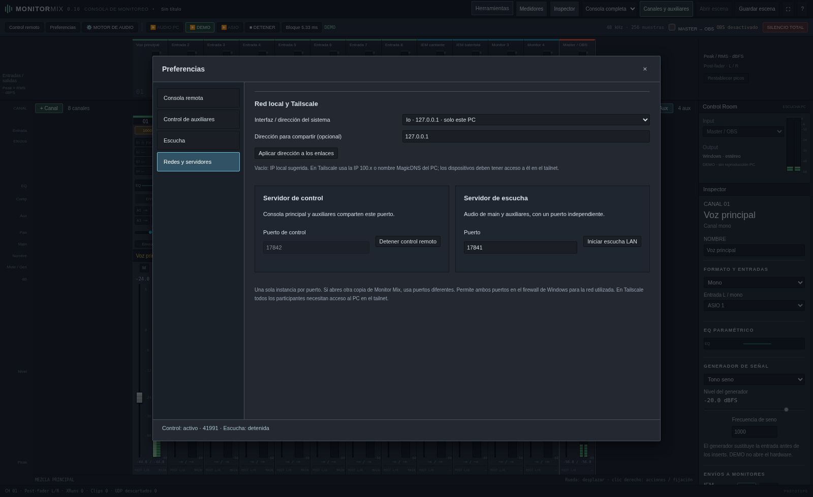
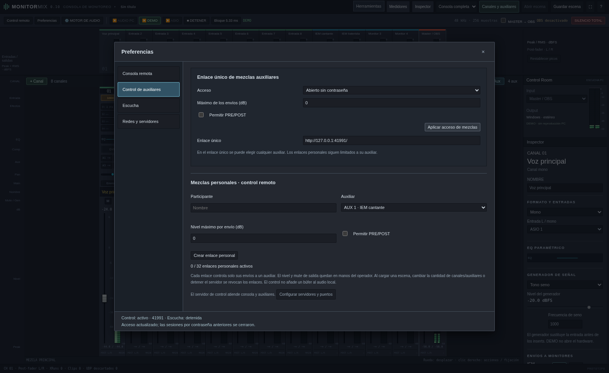

# Monitor Mix 0.10 · preferencias, touch manual y Windows

## Preferencias por categoría

El botón **Preferencias** abre una ventana con navegación lateral, como en las
referencias de REAPER y Fairlight. En pantalla pequeña la navegación pasa arriba.
Cada categoría tiene su propio panel; las flechas del teclado cambian de categoría.

- **Consola remota:** permiso de operador, contraseña opcional y enlace de la consola completa.
- **Control de auxiliares:** enlace compartido, límite de nivel, permiso PRE/POST y enlaces personales revocables por participante.
- **Escucha:** acceso, contraseña y enlace de audio independiente.
- **Redes y servidores:** interfaz/IP, LAN/Tailscale/MagicDNS, puertos e inicio/parada de ambos servidores.

Control de consola y auxiliares comparten el puerto TCP 17842. La escucha usa TCP
17841. Se pueden cambiar antes de iniciar cada servicio. El pie de preferencias
muestra el estado de ambos; un error de inicio identifica dirección y puerto y
queda visible en el pie. Los permisos siguen siendo independientes.

Los controles se aplican con el botón de cada apartado, como en 0.9: no hay un
botón global de guardar/cancelar que prometa revertir cambios ya aplicados.

## Touch por elección del usuario

La consola empieza en modo normal, incluso en un dispositivo con pantalla táctil.
Activa **Herramientas → Interfaz touch → Activada** cuando lo necesites. Se recuerda
por navegador. Una preferencia antigua «Automática» migra a desactivada; una
activación manual anterior se conserva. Las superficies específicas de auxiliares
y escucha mantienen su diseño responsive para móviles.

Herramientas ahora usa un popover por encima de la consola, anclado al botón y
limitado al tamaño de pantalla. Se recoloca al desplazar o redimensionar la ventana
y se cierra al pulsar fuera o Escape. Esto evita que el encabezado desplazable
recorte o desplace el menú en touch.

## Transporte y recuperación

El servidor lee cabeceras HTTP por bloques, conserva correctamente el cuerpo y
permite hasta cinco segundos para completar las cabeceras. Antes hacía una llamada
al sistema por byte y el control cortaba a los dos segundos. Son límites de
peticiones web, no búferes ni retardos añadidos al audio local.

El servidor local `tiny_http` también tiene una corrección de reservas de sus
trabajadores: varias conexiones keep-alive abiertas juntas podían ocupar todos
los trabajadores y dejar las siguientes peticiones en cola. La prueba dedicada
fallaba antes del cambio y ahora completa 12 ráfagas de 12 conexiones. El cambio
se conserva con las licencias y procedencia en `desktop/vendor/tiny-http/ORIGIN.md`.

Las consultas tienen un plazo de seis segundos y los fallos usan espera progresiva
hasta cuatro segundos en control. Una respuesta 403 sigue indicando un acceso
revocado/protegido; un fallo de transporte permite reconectar. Los cambios de
auxiliar pendientes se descartan al desconectar para no reproducir movimientos
antiguos cuando vuelva la red. Las escrituras no se reintentan automáticamente.

La escucha reintenta una conexión interrumpida conservando el AudioContext que el
usuario activó con Reproducir. Detener cancela stream, reintentos y sonido pendiente.
Al cambiar de bus se vacían las colas. Tras una acumulación se descarta audio viejo
en lugar de seguir reproduciendo segundos de atraso.

## Latencia de escucha

En la página de escucha puedes elegir el **objetivo de búfer**:

| Objetivo | Uso de referencia |
| --- | --- |
| 40 ms | Red estable; mayor sensibilidad a variaciones |
| 80 ms | Valor inicial equilibrado, antes 120 ms |
| 120 ms | Mayor tolerancia |
| 200 ms | Red con más variación |

El objetivo no es una latencia total garantizada: hay que sumar el comportamiento
real del navegador, dispositivo y transporte. La cola programada actual se muestra
en el diagnóstico. Se solicita `latencyHint: interactive` al navegador. PCM sigue
siendo estéreo float32 a 48 kHz, sin compresión, aproximadamente 3,07 Mbit/s por
oyente más cabeceras. Ocho oyentes demandan unos 24,6 Mbit/s de audio del PC.
Las colas siguen acotadas y el callback no hace red, espera, asignaciones ni bloqueos.
El modo de menor búfer debe probarse en cada red; no sustituye monitoreo de escenario.

## Icono de notificación de Windows

En un inicio normal **MonitorMix.exe** no abre una terminal. Mantiene un icono en la
bandeja de Windows, posiblemente dentro de «Mostrar iconos ocultos»:

- Doble clic o **Abrir consola** vuelve a abrir la ventana de control.
- Cerrar la consola deja el motor y los accesos remotos funcionando.
- **Salir (detiene el audio)** detiene el motor, los servidores y cierra el proceso.
- Una segunda ejecución normal intenta abrir la instancia existente en vez de
  iniciar otro motor y competir por los mismos puertos.

`--no-browser` se reserva para procesos de diagnóstico/automatización: no registra
instancia única ni icono. Sus servicios deben usar puertos diferentes si coinciden
con una instancia de escritorio. Si Windows reinicia Explorer se vuelve a registrar
el icono. Esta integración está compilada para Windows; su interacción nativa
requiere comprobarse en un PC Windows.

## Firma

Esta versión aún no está firmada con Authenticode. Consulta
[identidad, opciones gratuitas y preparación de firma](firma-windows.md).
La firma y SmartScreen son cuestiones distintas: una firma válida no garantiza
la ausencia de avisos o detecciones.

## Validación

Se prueban el mezclador y sus restricciones de tiempo real, el puente contra
libobs real, la separación de buses PCM y permisos, peticiones TCP fragmentadas
con retrasos superiores a dos segundos, conflictos de puertos y flujos en Chromium
con touch real simulado. Las pruebas de navegador interrumpen una escucha y
comprueban que reconecta conservando el contexto de audio. No son mediciones con
Wi-Fi físico, enlaces Tailscale reales o hardware ASIO de estudio.
