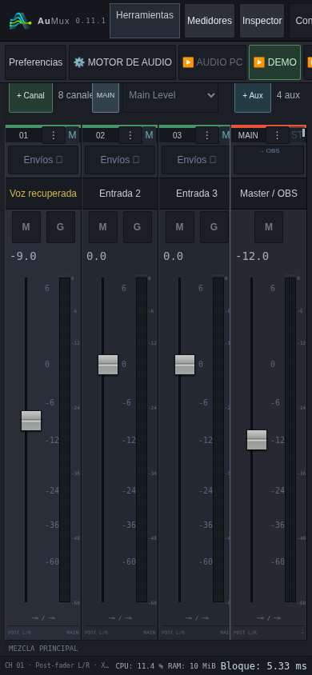

# AuMux 0.11.1 · consola completa remota en Windows

[Descargar Windows x64](../dist/AuMux-0.11.1-Windows-x64.zip).

La captura recibida mostraba el HTML y el logo, sin estilos, canales generados ni
estado del motor. Los archivos CSS/JavaScript y las respuestas de datos requieren
peticiones adicionales al servidor de control.

## Fallo corregido

El listener se abre en modo no bloqueante para poder aceptar conexiones y pararse
sin esperar indefinidamente. En Winsock, el socket aceptado hereda ese modo. Rust
usa `accept` sin cambiarlo; en Linux la condición no aparece de la misma manera.
Los trabajadores HTTP leían y escribían como si la conexión fuera bloqueante:

- Si aún no llegaban todos los bytes de las cabeceras, `peek` podía devolver
  `WouldBlock` inmediatamente, aunque hubiese un plazo de lectura de cinco segundos.
- Si se llenaba el búfer de salida al descargar CSS/JavaScript/JSON, `write_all`
  podía fallar y terminar una respuesta antes de completarla.

El helper HTTP ahora restablece explícitamente el modo bloqueante de la conexión.
Sus plazos de lectura y escritura siguen acotando las esperas del trabajador web.
El WebSocket de auxiliares vuelve deliberadamente a modo no bloqueante después de
completar la negociación HTTP. El callback de audio no hace estas operaciones.

Referencias: [Microsoft sobre accept](https://learn.microsoft.com/en-us/windows/win32/api/winsock2/nf-winsock2-accept)
y [implementación Windows de Rust 1.95](https://github.com/rust-lang/rust/blob/1.95.0/library/std/src/sys/net/connection/socket/windows.rs).

## Pruebas

La prueba Rust fuerza un socket aceptado no bloqueante en cualquier host,
retrasa y fragmenta las cabeceras y lee despacio una respuesta de ocho MiB.
Fallaba antes con `WouldBlock` y pasa después, verificando todos los bytes.
Esto reproduce la condición relevante de Windows sin afirmar que se haya
realizado una prueba nativa en un PC Windows.

`desktop/tests/console-network-ui.cjs` usa AuMux real y Chromium móvil a través
de un proxy TCP que fragmenta cabeceras y fracciona las respuestas. Comprueba:

- Carga completa de los cinco archivos CSS/JavaScript y estilos realmente aplicados.
- Consultas periódicas durante más de diez segundos sin errores de transporte.
- Escrituras reales en la consola y recuperación del estado tras perder la red.
- Inicio con contraseña, cookie HttpOnly y recargas conservando el acceso.

Las pruebas de auxiliares WebSocket, escucha y separación de permisos siguen
ejecutándose. No se mide aquí Wi-Fi/Tailscale físico ni latencia de audio.

## Probar el parche

1. Cierra el servicio anterior desde el icono de bandeja.
2. Extrae todo el ZIP y abre **AuMux.exe**.
3. Inicia el servidor de control y habilita la consola remota en Preferencias.
4. Vuelve a abrir el enlace `/console/`; comprueba la marca **0.11.1**.
5. Prueba primero la carga completa y después un fader. El modo touch se activa
   manualmente desde Herramientas.

Los límites de tiempo web no son búferes añadidos al audio. La escucha y el motor
mantienen sus rutas y formatos existentes. Este parche corrige una causa concreta;
la estabilidad en el equipo del estudio debe verificarse con su red y Windows.
