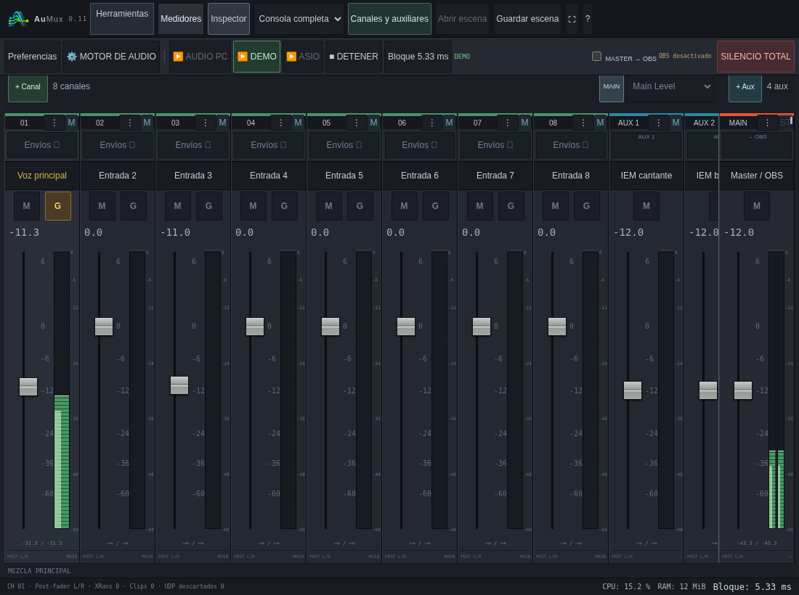
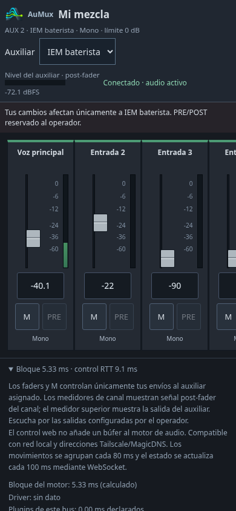
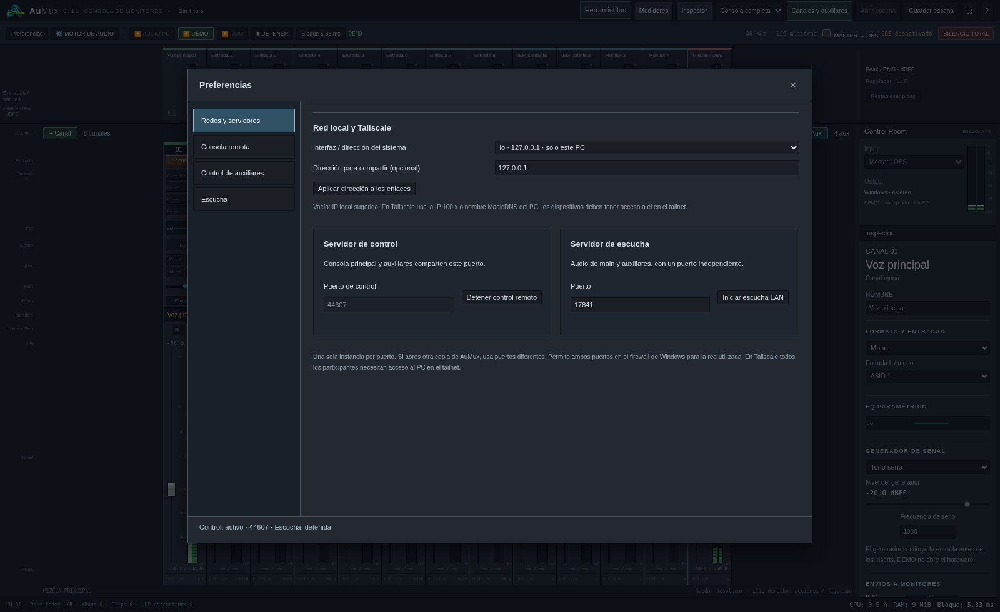
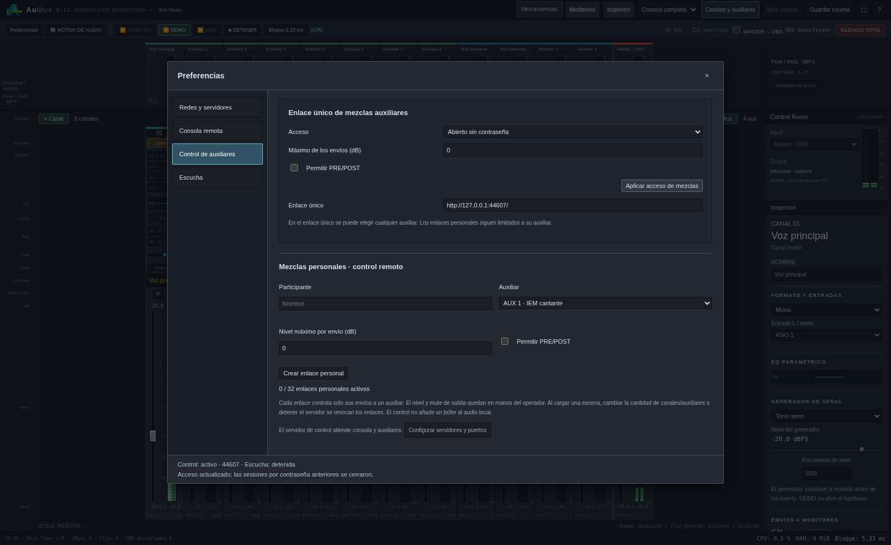
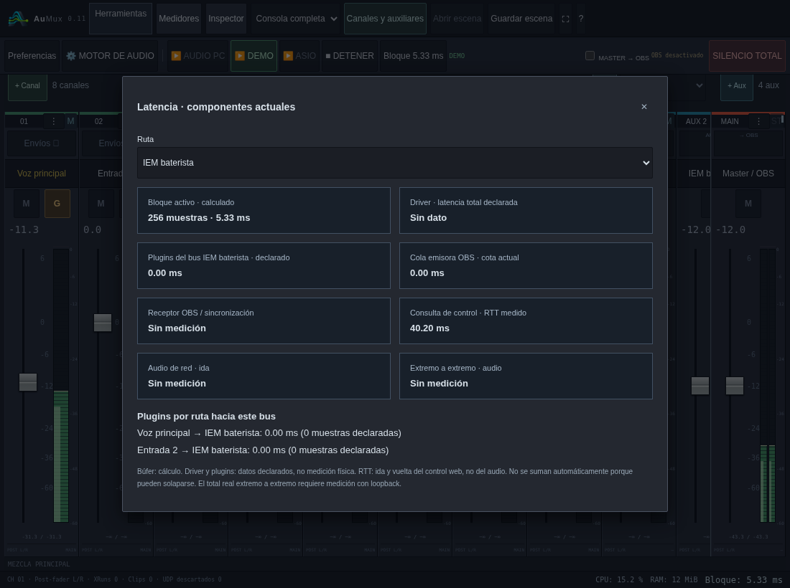
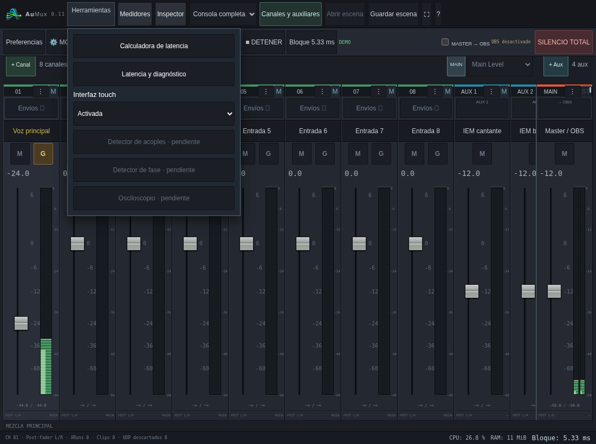

# AuMux 0.11 · auxiliares WebSocket y estado del sistema

[Descargar Windows x64](../dist/AuMux-0.11.0-Windows-x64.zip). Extrae todo,
cierra la versión anterior y ejecuta **AuMux.exe**. La marca superior debe mostrar
**AuMux 0.11**. Antes se llamaba Monitor Mix; tus escenas y presets siguen siendo
compatibles.

## Control de auxiliares por WebSocket

El control de auxiliares deja de consultar y modificar cada envío con peticiones
HTTP periódicas y usa una conexión WebSocket independiente del audio:

- El navegador agrupa los últimos cambios de nivel, mute y PRE/POST cada **80 ms**.
  Varios movimientos del mismo control dentro de una tanda conservan el último
  valor; no se reproduce una cola de posiciones intermedias.
- El motor publica el estado de la mezcla cada **100 ms**. Confirma los cambios
  después de aplicarlos, conservando los permisos de auxiliar, nivel máximo y
  PRE/POST.
- Si se interrumpe la conexión, aparece **Reconectando…**, sin vaciar la consola.
  Se descartan los movimientos pendientes y la siguiente conexión recupera el
  estado actual del motor antes de habilitar nuevamente los controles.
- Un enlace revocado o una sesión que requiere contraseña no se trata como una
  interrupción de transporte. Se muestra el motivo y se exige acceso válido.

**80 ms es el intervalo de envío, no la latencia total garantizada.** Se suman el
viaje por red, la aplicación y la actualización del navegador. La escucha de
audio y el callback local conservan sus caminos separados; estos intervalos no
se añaden al audio local. La consola completa remota conserva su API de control.

Los enlaces LAN, Tailscale y MagicDNS mantienen el mismo formato. El WebSocket
usa el puerto del servidor de control, normalmente TCP **17842**; no requiere
otro puerto ni convierte el audio en mensajes de control. Las contraseñas,
cookies y enlaces personales siguen autorizando cada conexión y sus cambios.
Por HTTP directo se usa `ws://`; Tailscale protege el tráfico dentro de su túnel.

No se da por comprobada una causa única de los cortes observados en Wi-Fi: la
versión anterior usaba peticiones periódicas y plazos de espera que podían
interrumpirlas. Esta versión cambia el transporte y el manejo de reconexión;
las sesiones prolongadas en el PC y la red reales siguen siendo necesarias.

## Preferencias con redes primero

Abre **Preferencias**. La lista lateral comienza con **Redes y servidores**, donde
se eligen la interfaz, IP local/Tailscale o nombre para los enlaces y los puertos
de los servidores. Las demás categorías mantienen configuraciones independientes:

1. **Redes y servidores:** direcciones compartidas, servidor de control y escucha.
2. **Consola remota:** acceso a la superficie principal, abierto, con contraseña o
   deshabilitado.
3. **Control de auxiliares:** enlace compartido con selector de auxiliar,
   contraseña opcional, permisos y enlaces personales revocables.
4. **Escucha:** acceso al audio por navegador y enlace de escucha.

El bloque antiguo de control remoto desaparece de la superficie principal.
Las opciones se gestionan desde Preferencias; no son una única función con un
único permiso. Cambiar la dirección para compartir no cambia el dispositivo de
audio ni obliga al motor a detenerse.

## CPU, RAM y latencia

El pie de consola sustituye el texto de prototipo por indicadores del proceso:

- **CPU:** porcentaje de CPU consumida por AuMux respecto de la capacidad total
  del equipo. No es el uso global de Windows ni el porcentaje de tiempo del
  callback de audio.
- **RAM:** memoria residente del proceso, que incluye motor y plugins cargados.
  El navegador que dibuja la consola es otro proceso y no está incluido.
- **Latencia:** la declarada por el driver cuando existe; si falta, se identifica
  explícitamente la duración del bloque a 48 kHz. Ninguna representa por sí sola
  una medición física completa desde la entrada hasta los audífonos.

Son muestras periódicas fuera del callback; pueden tardar un intervalo en
actualizarse. **Herramientas → Latencia actual** sigue mostrando los componentes
por separado: bloque, driver, inserts y colas disponibles, con las rutas de audio
no medidas marcadas como desconocidas.

## Bandeja de Windows y cierre

El inicio normal mantiene el servicio en la zona de notificaciones y abre la
consola. El menú del icono tiene este orden:

1. **Abrir consola** — acción disponible.
2. **IP local** — información, sin acción.
3. **Latencia del sistema** — información, con el mismo criterio del pie.
4. **Uso de CPU** — información de este proceso.
5. **Uso de RAM** — información de este proceso.
6. **Cerrar servicio** — solicita confirmación.

El diálogo de cierre ofrece **Sí** y **No**, con **No** como opción inicial.
**No** conserva el motor, los servidores y el audio; **Sí** finaliza el servicio.
Cerrar la ventana del navegador deja el servicio activo. Para volver a ella,
usa **Abrir consola**. La implementación de bandeja se compila para Windows;
su comportamiento nativo necesita verificarse en el PC de prueba.

## Touch y compatibilidad

Touch se activa manualmente en **Herramientas → Interfaz touch**, por navegador.
La consola completa remota tampoco lo activa automáticamente por usar tablet.
El menú de herramientas se coloca junto a su botón y se ajusta a la ventana.
Las páginas de mezcla y escucha conservan sus controles adaptados a móvil.

Se conservan deliberadamente nombres internos anteriores:

- `%LOCALAPPDATA%\MonitorMix\presets.json` para encontrar tus presets existentes.
- `monitor-mix-receiver.dll`, el protocolo UDP y el ID/nombre de fuente
  **Monitor Mix — master local** para conservar la integración y escenas OBS.
- Las variables de entorno `MONITOR_*` y los formatos de escenas anteriores.

El repositorio conserva la dirección `Lechuga-visual/audio-obs-asio`. Su cambio
de nombre queda pendiente: GitHub rechazó la operación de renombrado a la integración
(«Resource not accessible by integration», HTTP 403), aunque la consulta del
repositorio indique permisos de administración del usuario. No se cambió el
nombre remoto; el producto y el ejecutable ya son AuMux.

El ejecutable y el ZIP de esta entrega sí se llaman **AuMux.exe** y
**AuMux-0.11.0-Windows-x64.zip**. El logo suministrado se incluye en la interfaz,
la pestaña del navegador y los recursos del ejecutable. El paquete sigue sin
firma pública Authenticode; [firma e identidad](firma-windows.md) explica las
opciones, incluida la solicitud gratuita para proyectos abiertos.

La validación cubre audio, permisos, reconexión, UI y compilación cruzada;
no equivale a una prueba física prolongada de Wi-Fi/5G/Tailscale, hardware ASIO,
antivirus o bandeja nativa de Windows.

## Prueba de red del control

`desktop/tests/websocket-network-ui.cjs` usa AuMux real y Chromium con retrasos
controlados de 80, 250 y 800 ms por sentido. La prueba verificó respuestas de
control de aproximadamente 176, 515 y 1613 ms de ida y vuelta sin reconectar
por esos retrasos, y una sesión quieta de más de 16 segundos. También comprueba
cortes, modo sin red, recuperación de estado sin repetir cambios y ausencia de
consultas HTTP periódicas del auxiliar. Son ensayos de red simulada, no
mediciones físicas por Wi-Fi/Tailscale ni de latencia de audio.
