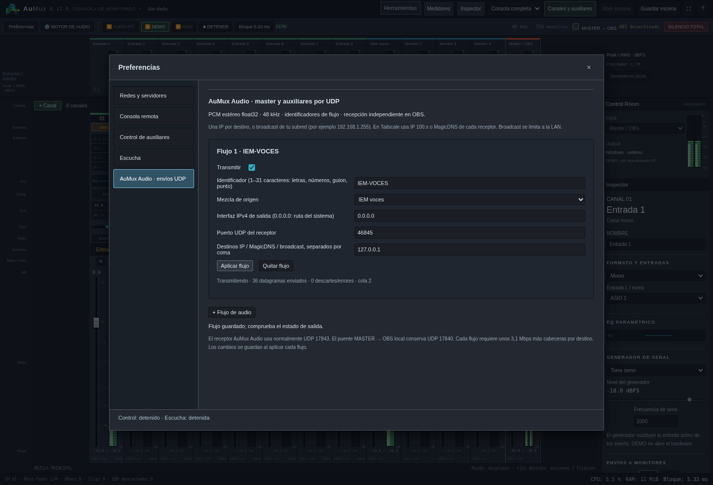
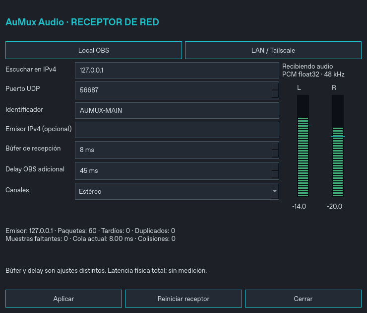

# AuMux 0.12 · AuMux Audio para OBS y red

[Windows x64](../dist/AuMux-0.12.0-Windows-x64.zip) ·
[Instalación y prueba](probar-en-windows.md) · [Puente OBS](puente-obs.md)

## Envíos desde AuMux

**Preferencias → AuMux Audio · envíos UDP** permite guardar hasta ocho flujos en
la escena. Cada flujo tiene activación, bus de origen, identificador ASCII de
1–31 caracteres, IPv4 de salida, puerto y hasta ocho destinos IPv4 o nombres
resolubles. Para broadcast se indica la dirección de difusión de la LAN.
Tailscale utiliza destinos directos. Los cambios se aplican con el motor activo.

La resolución de nombres usa trabajadores acotados y queda fuera del callback.
El callback copia paquetes de hasta 128 muestras a colas acotadas y sin
asignaciones de memoria ni mutex. Un trabajador de red transmite el PCM ya
procesado del master o auxiliar. Cambiar un fader no reinicia los flujos.
Al llenarse una cola se conserva audio reciente y se contabilizan descartes.



## Receptor y editor

El nombre visible es **AuMux Audio**. El ID de fuente y la DLL histórica se
mantienen para conservar escenas. El preset local recibe el master MMX1 anterior.
El preset de red prepara escucha en todas las interfaces, puerto 17843 y 8 ms de
búfer; ese valor es un punto de partida para pruebas.

Cada fuente selecciona el identificador, filtro IPv4 opcional de emisor, búfer
0–100 ms y canales estéreo/mono/LR intercambiados. El editor configura el mismo
desplazamiento de sincronización de OBS, con pasos de 1 ms. El búfer que absorbe
jitter y el delay elegido para sincronizar con video se muestran por separado.

El receptor ordena por contador de muestras, descarta duplicados/tardíos, limita
la cola, sustituye audio faltante por silencio y recupera cambios de sesión.
Varias fuentes en el mismo proceso comparten socket y se filtran por flujo.
Los medidores proceden de las muestras entregadas a OBS, antes de su fader.
El botón **Reiniciar receptor** vuelve a abrir la recepción sin reiniciar OBS.



Windows usa un editor Win32 con los colores de AuMux y sin añadir un runtime Qt
al paquete. Linux usa Qt6. El núcleo de transporte y las opciones son compartidos.

## Protocolo propio AUM1

Datagramas UDP little-endian. PCM estéreo intercalado, float32, 48000 Hz. No es
compatible con ReaStream: se usa solamente como referencia de funcionamiento.

| Desplazamiento | Campo |
| --- | --- |
| 0–3 | ASCII `AUM1` |
| 4 / 5 | Versión 1 / dos canales |
| 6–7 | Cabecera de 80 bytes, uint16 |
| 8–15 | Sesión del flujo, uint64 |
| 16–19 | Secuencia de paquete, uint32 |
| 20–23 | Frecuencia: 48000, uint32 |
| 24–25 | Muestras por canal: 1–128, uint16 |
| 26–31 | Reservado, cero |
| 32–39 | Contador de muestras por canal, uint64 |
| 40–71 | Identificador ASCII terminado en cero y rellenado con ceros |
| 72–79 | Identificador del emisor, uint64 |
| 80… | Audio L/R float32 intercalado |

Un paquete completo ocupa 1104 bytes, menor que 1200; se evita la fragmentación
en MTU habituales de LAN/Tailscale. Los 128 frames representan 2,67 ms a 48 kHz,
pero el emisor no espera a llenar un paquete cuando recibe un bloque menor.
El payload de una mezcla estéreo usa 3,072 Mbps, más cabeceras y encapsulación.
Se suma una copia por destino unicast. Broadcast es una copia dentro de la LAN.

El emisor cambia la sesión tras una pausa de transmisión para recuperar el reloj
sin reproducir una cola antigua. Los identificadores no autentican ni cifran los
paquetes. El filtro de emisor es una selección de origen, no una contraseña.

## Plataformas y pruebas

- Windows x64: app y DLL compiladas; editor Win32 incluido.
- Linux x64: plugin y editor Qt6 compilados; pruebas contra libobs real y editor
  ejecutado con captura de pantalla. No es validación de todas las distribuciones.
- macOS: núcleo POSIX y editor Qt6 preparados con CMake; todavía sin compilación,
  firma/notarización ni pruebas nativas en Intel/Apple Silicon.
- Flatpak: empaquetado e integración con el runtime de OBS pendientes.

Pruebas añadidas:

- Rust: límites, configuración, flujo del bus correcto, tamaño de datagramas y
  ausencia de asignaciones/destrucciones en la copia del callback.
- `audio-network-smoke.py`: AuMux real, aislamiento master/aux por frecuencia,
  varios destinos, resolución de nombres, broadcast en loopback, errores de
  interfaz, silencio/reanudación y auxiliar enviado al receptor real de libobs.
- `obs-network-test.cpp`: puerto compartido, aislamiento, reordenamiento,
  duplicados, audio faltante, sincronización nativa y destrucción de suscriptores.
- `obs-ui-test.cpp`: editor Qt6 real, presets, Aplicar, sincronización con OBS,
  medición de señal y una ventana por fuente.
- `audio-network-ui.cjs`: configuración desde Preferencias, recepción de PCM,
  nombres, rechazo de identificadores duplicados y persistencia en escenas.

La compilación portable está en `desktop/native/obs-plugin/CMakeLists.txt`.
Requiere SDK de libobs y Qt6 Widgets compatibles con la instalación concreta
de OBS en Linux/macOS; Windows usa Win32.

```bash
cmake -S desktop/native/obs-plugin -B build/obs-plugin -DCMAKE_BUILD_TYPE=Release
cmake --build build/obs-plugin
cmake --install build/obs-plugin --prefix build/obs-plugin-stage
```

Quedan las pruebas físicas entre equipos, Wi-Fi, Tailscale y sesiones prolongadas
con relojes de hardware distintos. No se ha medido la latencia física total ni
se promete sincronización de reloj de dispositivos a partir de estos tests.
