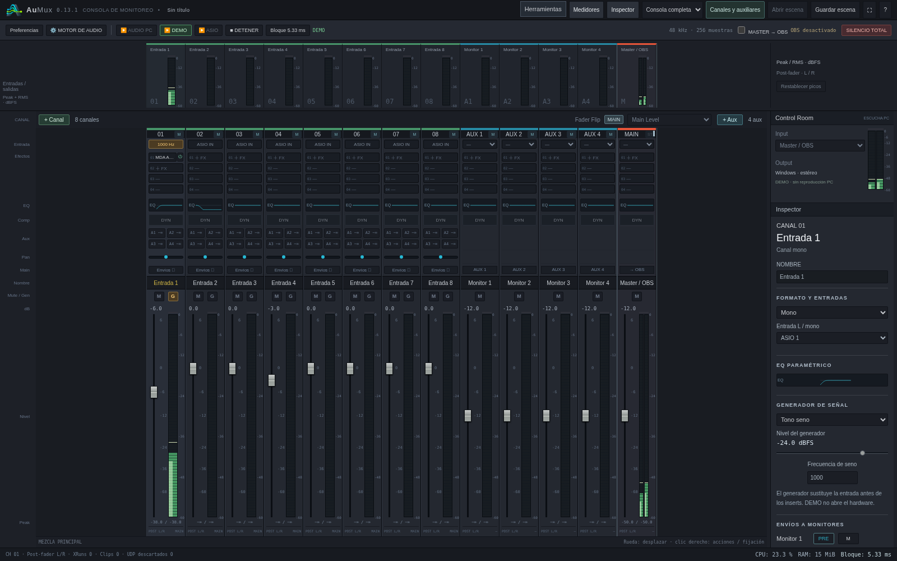

# AuMux 0.13.1 · ventanas independientes y paneles flotantes

[Descargar Windows x64](../dist/AuMux-0.13.1-Windows-x64.zip) ·
[Instalación](probar-en-windows.md) · [Herramientas de audio](interfaz-0.13.md)

Herramientas, cadena de plugins, EQ, compresor, envíos, preferencias y motor de
audio se abren sin bloquear la consola principal. Los diálogos de ayuda y de
cambio de cantidad de canales conservan su funcionamiento modal.

## Ventanas independientes

Es el modo predeterminado. Cada panel se abre en una ventana del navegador con
su propio tamaño, que el sistema permite mover a otro monitor. Abrir EQ o FX
de canales diferentes crea ventanas distintas. Volver a abrir el mismo panel
desde la consola enfoca su ventana existente. La cadena permite seleccionar
sus inserts dentro de esa ventana.

Todos los paneles usan **el mismo servicio y motor de audio**. Se pueden mover
faders, cambiar envíos y ajustar efectos desde la consola mientras un panel está
abierto. El texto numérico que se está escribiendo se conserva hasta aplicarlo. Si otro
panel elimina un insert, el editor anterior se actualiza sin restaurarlo al
cerrar. Los cambios se sincronizan también cuando el servicio remoto está
apagado; no hace falta activar ningún puerto de control remoto.

Cerrar una ventana de panel no detiene el audio ni cierra los otros paneles.
Para cerrar el motor se mantienen DETENER y Cerrar servicio en la bandeja.
Los ajustes en vivo conservan su aplicación automática; Aplicar y el cierre
propio de la cadena guardan los parámetros que lo requieren. Se mantienen los
límites existentes: cambios de dispositivo/driver, cadenas y parámetros VST3
que exigen detener el motor siguen exigiéndolo. Separar la ventana no elimina
esas restricciones.

## Paneles flotantes dentro de la consola

**Herramientas → Paneles → Flotantes en la consola** conserva los paneles dentro
de la misma ventana, sin volverlos modales. Se pueden arrastrar desde su título,
redimensionar y apilar. Escape cierra el panel superior; la cadena de efectos
conserva su guardado antes de cerrar.

El botón **↗** del encabezado permite separar un panel en una ventana independiente.
La preferencia de modo se guarda en el navegador. Si el navegador bloquea las
ventanas emergentes, AuMux muestra el aviso y abre un panel flotante para que
se pueda seguir trabajando. Para moverlo a otro monitor hay que permitir las
ventanas emergentes de la dirección de la consola. En móvil/tablet el navegador
puede abrirlo como pestaña; el modo flotante es la alternativa dentro de la página.

## Herramientas de análisis abiertas a la vez

Las vistas de fase, acoples y osciloscopio utilizan la captura de señal compartida
del motor. Se muestran las fuentes **reales de la captura actual**, además de los
selectores para iniciar otra. Iniciar una nueva captura cambia las fuentes que
se analizan; las otras ventanas pueden observarla. No se crean motores ni colas
de audio adicionales por ventana.

Cerrar una ventana antigua no cancela una captura que inició otra después.
Detener análisis es una acción explícita sobre la captura compartida. Los
informes y las preferencias pueden permanecer abiertos mientras se trabaja.

## Validación

Se prueban ventanas reales de Chromium: EQ simultáneos de dos canales, cadena
nativa, compresor, preferencias, calculadora, osciloscopio y fase. Se verifican
cambios de parámetros en ambos sentidos con la consola, faders de la consola
principal operativos, reutilización de ventanas, cierre independiente,
conservación de la captura de otra ventana, paneles flotantes arrastrables y
recuperación cuando el navegador bloquea un popup.

Las pruebas de interfaz corren en Linux. El paquete Windows se compila de forma
cruzada; el comportamiento del gestor de ventanas de Edge/Chrome en el PC del
estudio y la distribución entre monitores requieren la prueba local.
