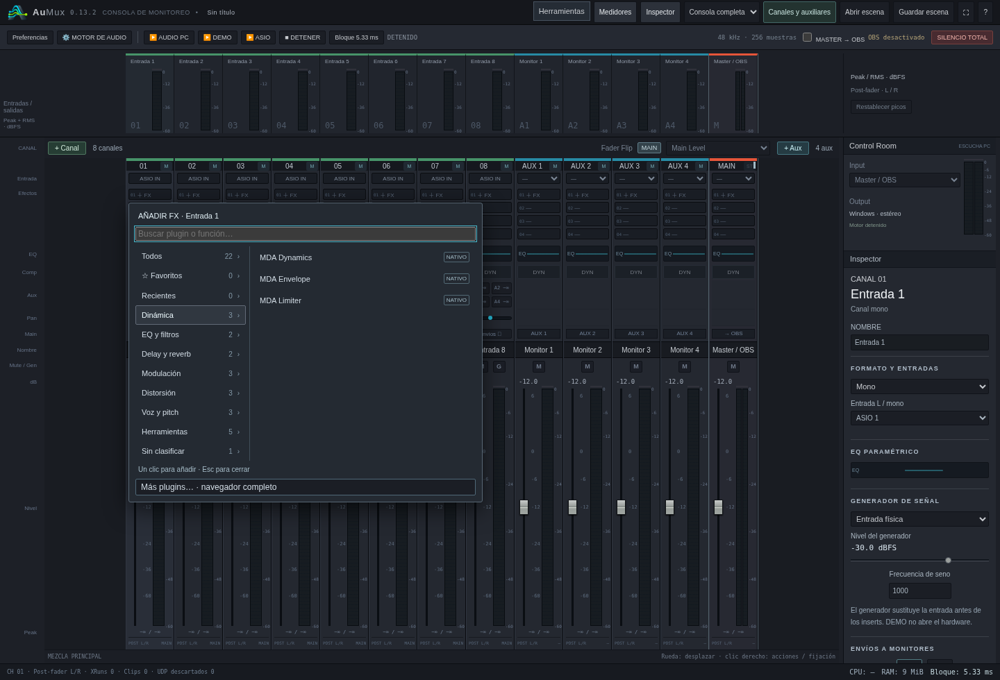
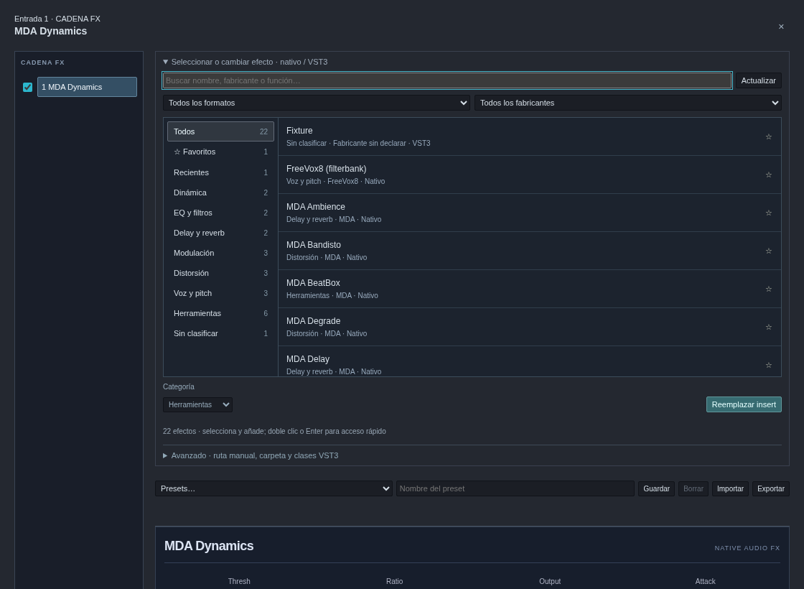

# AuMux 0.13.2 · selección de plugins por función

[Descargar Windows x64](../dist/AuMux-0.13.2-Windows-x64.zip) ·
[Instalación](probar-en-windows.md) · [Ventanas independientes](interfaz-0.13.1.md)

## Menú rápido desde cada tira

Pulsa **＋ FX** en un espacio libre de un canal, auxiliar o master. Se abre un
menú junto al botón con buscador, favoritos, recientes y categorías por función.
Con mouse, pasar por una categoría muestra sus efectos; con touch se selecciona
la categoría con un toque. Pulsar un efecto lo añade directamente, sin abrir el
editor. Pulsar un insert ocupado sigue abriendo su ventana de plugins.

**Más plugins…** abre el navegador completo de la misma cadena en su ventana
independiente, o en un panel flotante si elegiste ese modo. Escape y un clic fuera
cierran el menú rápido. El menú permanece dentro de la pantalla en móvil.

## Navegador completo en la ventana de plugins

**Seleccionar o cambiar efecto** muestra categorías a la izquierda y plugins a la
derecha, con nombre, función, fabricante y formato. Puedes buscar por esos datos,
filtrar **Nativos / VST3**, filtrar fabricante y marcar favoritos con **☆**.

Selecciona un efecto y pulsa **Añadir**, o usa doble clic / Enter. Si estás sobre
un insert ocupado, el botón indica **Reemplazar insert**: modifica ese espacio,
sin agregar otro. Para conservarlo y añadir otro, usa **＋ FX** en la lista de la
cadena. Los controles y presets del efecto cargado siguen debajo del navegador.

Las categorías son **Dinámica**, **EQ y filtros**, **Delay y reverb**,
**Modulación**, **Distorsión**, **Voz y pitch**, **Herramientas** y
**Sin clasificar**. Los 20 efectos MDA y FreeVox8 tienen clasificación inicial.
El EQ FreeEQ8 y el compresor propios de la tira conservan sus accesos específicos.
No se añaden instrumentos virtuales.

## VST3 instalados y categorías

**Actualizar** busca en las carpetas VST3 habituales del sistema y en la carpeta
adicional, configurable bajo **Avanzado**. La búsqueda lee los metadatos
`moduleinfo.json` que el fabricante incluya en el bundle; **no carga las DLL de
los VST3 durante la enumeración**. Cuando faltan esos metadatos, el bundle figura
en **Sin clasificar** hasta leerlo al seleccionarlo. Al cargarlo se recuerdan
nombre, fabricante y categorías declaradas, sin guardar parámetros de audio en
la biblioteca del navegador. Si contiene varios efectos, se actualiza la lista
para elegir uno explícitamente; no se selecciona el primero a ciegas.

Selecciona un plugin y usa **Categoría** para corregir su clasificación, o vuelve
a **Según el plugin**. Favoritos, los últimos 12 efectos utilizados, metadatos
leídos y categorías manuales se guardan en ese navegador y se comparten entre
ventanas del mismo origen. No se transfieren automáticamente a otro PC,
navegador o dirección de acceso remoto. Si el navegador bloquea el almacenamiento,
la selección funciona, pero esas preferencias no persisten al recargar.

La entrada manual de rutas, selección de clases y el selector anterior quedan
bajo **Avanzado** para diagnósticos y bundles especiales.

## Audio y sincronización

Se conserva el máximo actual de **cuatro inserts por cadena**. Añadir, reemplazar,
quitar o reordenar requiere detener el motor en la interfaz; buscar y organizar
la biblioteca no cambia la señal. Los parámetros nativos y bypass mantienen
su funcionamiento en vivo. No se añaden buffers ni procesamiento al callback de
audio para estas funciones.

Un selector abierto detecta si su cadena cambió antes de insertar y pide volver
a abrirlo, evitando sobreescribir esa cadena. Al reemplazar un efecto desde otra
ventana, las demás adoptan el esquema del nuevo plugin sin conservar parámetros
incompatibles del anterior.

## Validación

Pruebas con Chromium en Linux y DSP real: inserción directa en canal, auxiliar
y master, hover y búsqueda sin inspeccionar DLL, filtros, favoritos, categoría
manual, historial, persistencia, ventana FX independiente, acceso Más plugins,
doble clic, rechazo de una cadena cambiada y límites del menú en móvil. También
se carga un VST3 de prueba real. El parser de metadatos excluye controladores,
instrumentos y clases con identificadores inválidos.

El paquete Windows se compila de forma cruzada. Queda pendiente probar el
comportamiento nativo en Windows y con los VST3 instalados en el PC de estudio.
