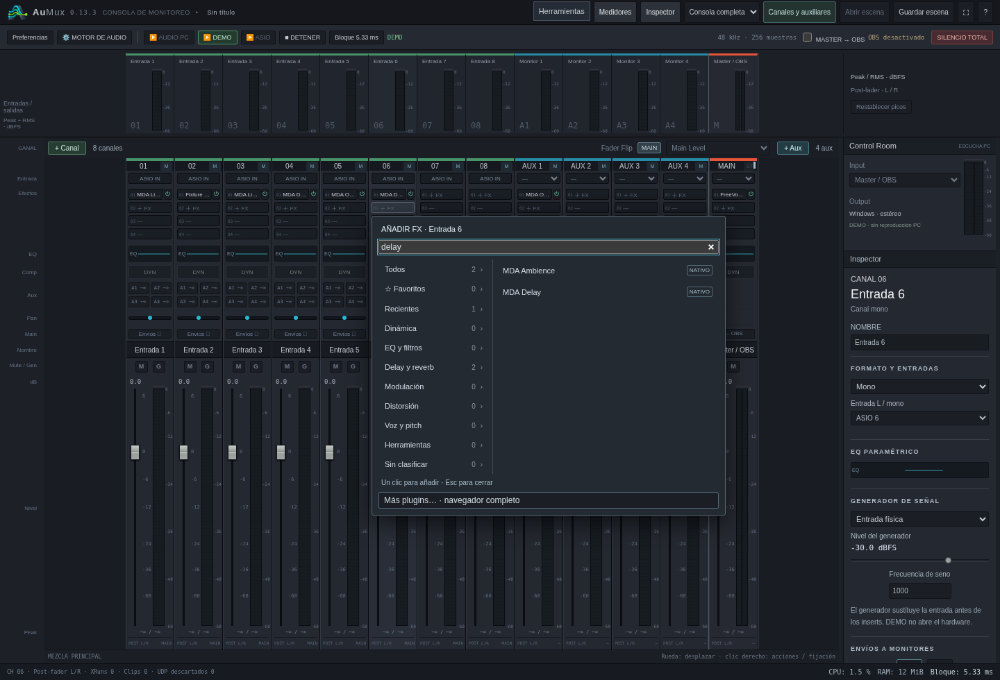

# AuMux 0.13.3 · cadenas de efectos en vivo

[Descargar Windows x64](https://github.com/Lechuga-visual/aumux-consola-virtual/releases/download/v0.13.3/AuMux-0.13.3-Windows-x64.zip) ·
[Instalación](probar-en-windows.md) · [Selectores de plugins](interfaz-0.13.2.md)

## Añadir y ordenar sin detener el audio

Puedes **añadir, reemplazar, quitar y reordenar inserts nativos o VST3** en
canales, auxiliares y master mientras el motor sigue funcionando. Se habilitan
el menú rápido **＋ FX**, el navegador completo y los botones **↑ / ↓ / Quitar**
de la ventana de plugins. Se conserva el límite de cuatro inserts por cadena.

Los nuevos plugins se cargan y preparan fuera del hilo de audio. La cadena
anterior sigue procesando hasta el intercambio entre bloques; los plugins que
permanecen se transfieren a sus nuevos espacios sin reiniciarlos. Cada insert tiene una identidad propia, incluso cuando hay
varias copias del mismo plugin. Las escenas antiguas reciben identificadores
estables al cargarse. Los retirados
se destruyen en el hilo de control. Si la preparación devuelve un error, no se
publica esa configuración y la cadena anterior sigue activa.

Solo las cadenas cambiadas hacen una transición de un bloque desde sus efectos
hacia la señal sin efectos y otro desde esa señal hacia la nueva cadena. No se
silencia la consola completa. La transición dura dos bloques en total: por
ejemplo, unos 5,33 ms con bloques de 128 muestras a 48 kHz. Es un fundido, **no
latencia añadida mediante una cola**. El carácter de la señal puede cambiar y la
latencia propia de los plugins nuevos sí puede aumentar la de su ruta. Los
efectos que se retiran no mantienen una cola de reverb/delay independiente.

El motor **DEMO** ahora renderiza en su propio hilo, para que la preparación de
plugins en el hilo de control no interrumpa el audio de prueba, su escucha web o
los envíos a OBS/red. ASIO y AUDIO PC conservan sus callbacks independientes.
Los contadores de trabajo DSP se conservan al intercambiar cadenas.

## Qué cambios siguen requiriendo detener el motor

| Cambio | ¿Detener audio? |
| --- | --- |
| Añadir, reemplazar, quitar o reordenar inserts | No |
| Buscar e inspeccionar un VST3 para cargarlo | No |
| Faders, pan, mute/solo, envíos, bypass, EQ y compresor | No |
| Parámetros y presets de efectos nativos | No |
| Parámetros/presets de un VST3 que ya está activo, desde su editor | Sí, la interfaz mantiene esa restricción |
| Canal/aux nuevo o mono/estéreo dentro de las entradas/salidas abiertas | No |
| Dispositivo, entradas físicas abiertas, buffer o cambiar ASIO / AUDIO PC / DEMO | Sí |
| Abrir otra escena o iniciar el barrido automático de buffers | Sí; el barrido administra sus arranques y paradas |

Un VST3 nuevo puede configurarse como borrador antes de aplicarlo. Una vez
insertado en una cadena activa, su editor queda de solo lectura para parámetros;
el bypass y el orden siguen disponibles.

Si hay una **captura de diagnóstico** activa, detén esa captura antes de cambiar
cadenas o estructura. Esto conserva la validez de la medición; no exige detener
el motor de audio. El propio medidor de loopback requiere ASIO funcionando.

## Validación y límites de las pruebas

- Callback real del backend con driver simulado: intercambios de estructura y
  cadenas sin reiniciar el stream ni reservar/liberar memoria Rust en el callback.
- Pruebas de identidad de instancias: reordenar y retirar efectos conserva los
  plugins que permanecen, también en otras tiras.
- PCM de monitoreo real de DEMO durante inserción, cambio de orden y retirada de
  efectos nativos/VST3 en canal, master y auxiliar. Audio finito, contadores DSP
  continuos y configuración intacta tras intentar cargar un archivo inexistente.
- Navegador real con ventanas FX independientes: insertar nativos y VST3, ordenar
  y eliminar mientras DEMO permanece activo.
- La preparación de un plugin ocurre fuera del callback. El DSP de terceros sigue
  teniendo su propio coste; estas pruebas no certifican la carga ni la estabilidad
  de todos los VST3 existentes.

Las pruebas se ejecutan en Linux con un VST3 de fixture real. El binario Windows
x64 se compila de forma cruzada; faltan la prueba nativa en Windows y las
mediciones con hardware ASIO. Los intervalos de llegada del monitor en loopback
no son mediciones de latencia física de audio.
