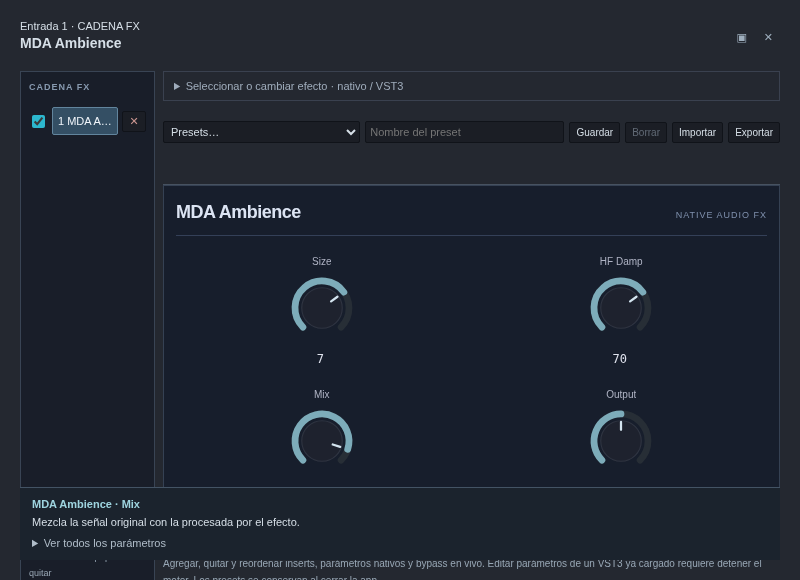
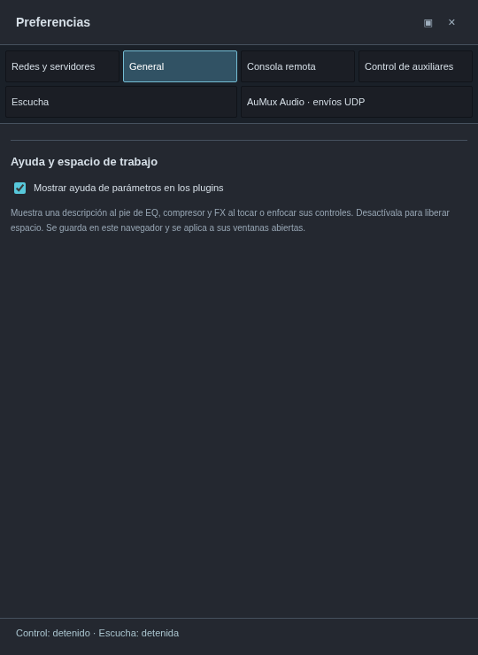
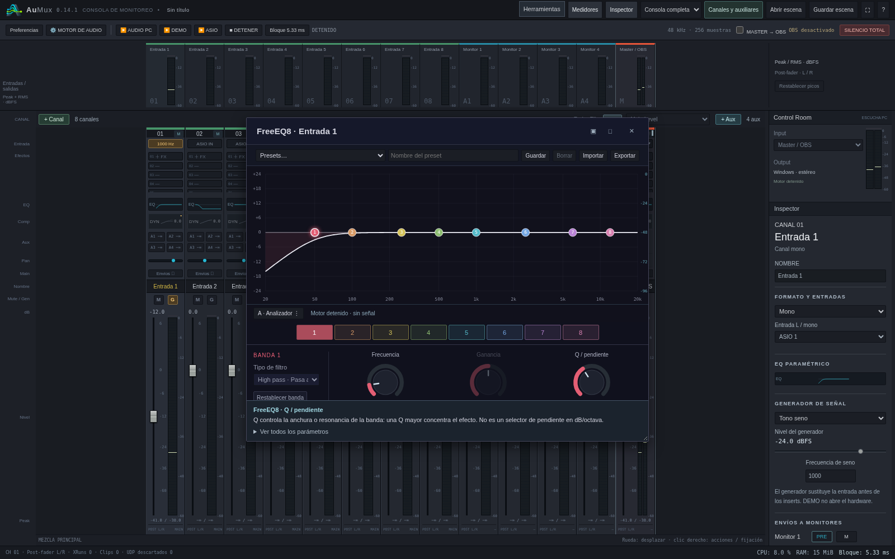
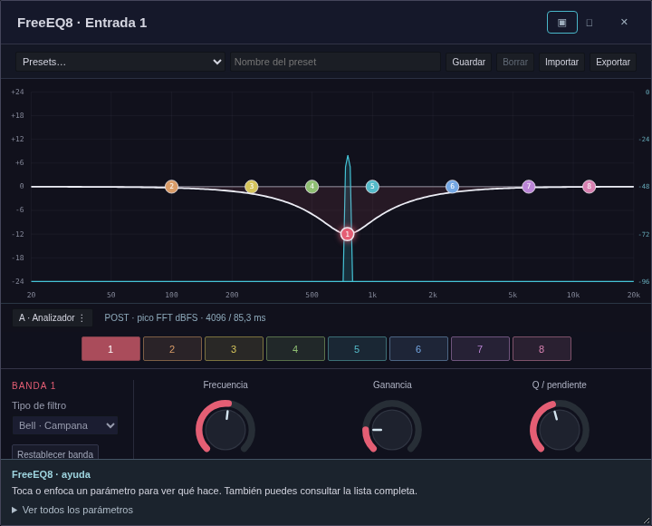
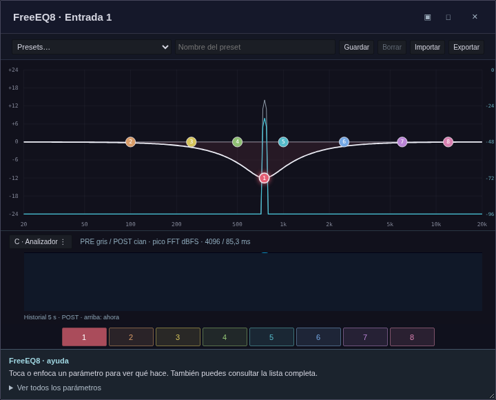

# AuMux 0.14.1 · analizador del EQ, ayuda y ventanas compactas

[Descargar Windows x64](https://github.com/Lechuga-visual/aumux-consola-virtual/releases/download/v0.14.1/AuMux-0.14.1-Windows-x64.zip)

## Ayuda de parámetros

**Preferencias → General → Mostrar ayuda de parámetros en los plugins** activa
u oculta la ayuda al pie de EQ, compresor y FX. Está activada inicialmente y se
guarda por navegador/origen; cambiarla actualiza también las ventanas abiertas
del mismo origen. Un navegador remoto puede elegir su propia preferencia.

Al tocar, enfocar con teclado o pasar por un control se explica su función.
**Ver todos los parámetros** despliega las descripciones completas. Los 20
plugins MDA, FreeVox8, el EQ y el compresor tienen textos propios. No se cambia
ningún parámetro ni se detiene el audio al consultar u ocultar la ayuda.

Los VST3 externos enumeran controles y rangos, pero esta integración no recibe
un manual de cada plugin. En esos casos se indica el rango comunicado y se
explica que hace falta consultar al fabricante; una escala normalizada 0–1 no
se presenta como un valor físico en dB/Hz ni se inventa su significado.

## Tamaño de paneles

El cálculo de tamaño se aplica ahora **también a los paneles flotantes** dentro
de la consola. Las ventanas independientes tienen límites nominales más pequeños
y solicitan el tamaño exterior, incluida la decoración del navegador. El botón
**▣ · Restablecer tamaño compacto** del encabezado permite recuperar el tamaño
inicial después de agrandar un panel. Se puede seguir redimensionando a mano.

Ejemplos en un área disponible de 1920 × 1080:

| Editor | Tamaño máximo inicial solicitado |
| --- | --- |
| FX | 800 × 580 |
| EQ | 820 × 580 |
| Compresor | 700 × 540 |
| Preferencias | 540 × 740 |
| Calculadora | 520 × 420 |

Siguen aplicándose los límites relativos de 45 % × 60 % para efectos/herramientas
y 30 % × 80 % para preferencias en escritorio. Un panel flotante puede ser más
bajo cuando su contenido lo permite. Los controles se redistribuyen según el
ancho del propio panel, aunque la consola principal sea grande; las preferencias
estrechas ponen las categorías arriba. En pantallas de menos de 720 px se usa
el ancho disponible para mantener los controles utilizables.

El navegador o sistema puede imponer mínimos, ignorar el cambio de tamaño o
usar una pestaña en móviles. AuMux no fuerza ventanas existentes a encogerse
mientras trabajas; usa ▣ cuando quieras volver al tamaño compacto.

## Niveles iniciales

Las escenas nuevas empiezan con faders de canales, auxiliares y master a **0 dB**.
Los canales y auxiliares añadidos a una escena también empiezan a 0 dB. Una escena
existente conserva los niveles que ya tenías guardados: actualizar no cambia
repentinamente su ganancia. Para poner una tira existente a 0 dB puedes hacer
doble clic en su fader o usar su menú contextual de unidad.

Los envíos nuevos siguen apagados y los generadores desactivados, para que añadir
una tira no cambie automáticamente el ruteo ni active una señal de prueba.

## Analizador del EQ

El EQ incorpora espectro **real**, para canales, auxiliares y master. La vista
inicial es **A · Compacto**, con una traza POST. Haz **clic derecho sobre la gráfica**
o pulsa **Analizador ⋮** para elegir:

- **A · Compacto:** una traza PRE o POST, seleccionable desde el menú.
- **B · Comparar PRE / POST:** entrada gris y salida cian superpuestas.
- **C · Espectro + historial:** comparación e historial POST de los últimos cinco
  segundos. Arriba queda lo más reciente.

El menú también permite congelar/reanudar la imagen, activar/restablecer picos y
apagar/encender el analizador. Congelar afecta únicamente la imagen. Se guardan
vista, fuente compacta, picos y encendido por navegador/origen. El gráfico admite
**Mayús + F10** o tecla de menú contextual; el botón facilita su uso táctil.

**PRE y POST rodean únicamente el EQ**, antes de su compresor, inserts y fader;
el mute de la tira tampoco borra una señal existente en ese punto. Los puntos de
grabación PRE/POST conservan su significado distinto: POST de grabación sí incluye
los procesos posteriores y el fader.

La escala derecha del espectro es **dBFS de pico FFT**; la izquierda sigue siendo
la ganancia del EQ en dB. Se usa Hann de 4096 muestras a 48 kHz: observación de
85,3 ms, bins de 11,72 Hz y suavizado visual de potencia. Un seno centrado en un
bin, a −20 dBFS de pico, se muestra a −20 dBFS; su RMS del medidor principal es
aproximadamente −23 dBFS. En estéreo se promedian potencias L/R, evitando que una
inversión de polaridad cancele el dibujo. Cada punto logarítmico conserva el pico
de los bins que abarca: no es un medidor de densidad de ruido ni de loudness.

El callback copia bloques a una cola limitada sin asignaciones de heap Rust,
locks, FFT ni operaciones de red. Un hilo separado hace el análisis. Las ventanas
piden el resultado aproximadamente cada 80 ms, con una sola petición pendiente;
los fallos de red se reintentan. Estos tiempos de imagen **no agregan un búfer a
la escucha**. Se admite un máximo de ocho tiras analizadas a la vez, compartiendo
el análisis entre ventanas del mismo canal/bus. Al cerrar, congelar o apagar el
último visor de una tira, su captura y FFT dejan de trabajar al vencer una espera
de unos 2,5 s. Omitir imágenes ante saturación no frena el audio, y los huecos
reinician la ventana para no analizar muestras discontinuas. La CPU adicional
sí depende de cuántas tiras estén abiertas.

El motor detenido o una captura sin datos recientes limpia el espectro; no se
muestra una animación simulada. La función convive con la grabación multipista y
los diagnósticos. [Maquetas originales](propuestas/analizador-eq.md).

## Validación

Se comprueban los niveles de una escena nueva y de tiras añadidas, la conservación
de ganancias existentes, cobertura de ayuda nativa, ayuda al enfocar controles,
la persistencia y sincronización de su interruptor entre ventanas, límites reales
de paneles flotantes, redistribución de controles y funcionamiento de ventanas
independientes en consola local y remota. También se comprueban calibración
FFT, estéreo con polaridades opuestas, ganancia real antes/después del EQ,
independencia de fader/mute/compresor/inserts, buses, cambio de vistas, historial,
congelación, picos, persistencia y continuidad al iniciar/detener una grabación.
El paquete Windows se compila de forma
cruzada; falta comprobar estos cambios en Windows nativo y con hardware ASIO.
