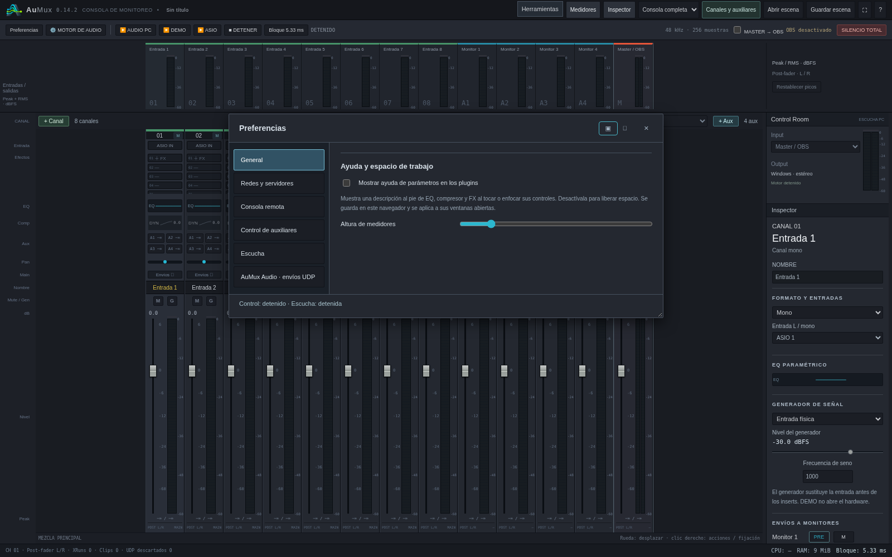
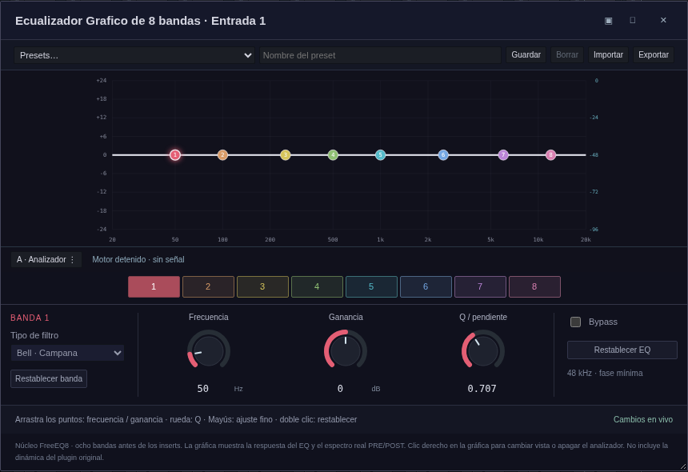
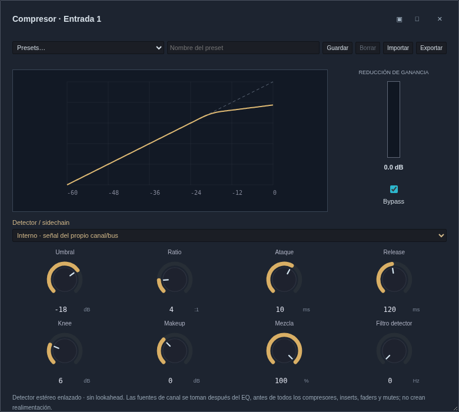
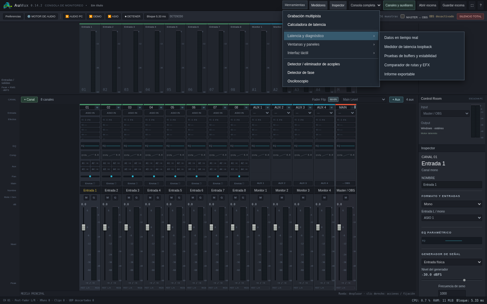

# AuMux 0.14.2 · editores y menús

[Descargar Windows](https://github.com/Lechuga-visual/aumux-consola-virtual/releases/download/v0.14.2/AuMux-0.14.2-Windows-x64.zip)

- **General** es la primera categoría de Preferencias y la que se abre inicialmente. Redes sigue después. Las categorías se mantienen al costado en escritorio; la ventana inicial es más ancha para que quepan.
- La ayuda de plugins empieza **apagada**. Una elección explícita anterior de encendido se conserva. Puedes cambiarla en General.
- **General → Altura de medidores** permite agrandar verticalmente el puente de medidores superiores, entre 90 y 360 px, limitado por la altura de la pantalla. Se guarda por navegador. No modifica la escala dBFS ni el audio.
- Herramientas usa filas compactas, separadores y submenús laterales para diagnósticos, paneles y modo táctil. Admite clic, hover con mouse, flechas y teclado. En pantallas estrechas se ajusta al espacio disponible.
- EQ y compresor tienen tamaños iniciales que priorizan mostrar todos sus controles, por encima de los límites de tamaño anteriores. El EQ reduce el espacio de su gráfico y perillas. En pantallas muy pequeñas o con ayuda/historial desplegados puede seguir siendo necesario desplazarse.
- El editor del EQ se presenta como **Ecualizador Grafico de 8 bandas**. Su procesamiento y controles paramétricos se conservan.
- Los selectores rápido y completo de FX muestran una descripción breve. Los efectos nativos tienen descripciones propias; para VST3 externos se usa la categoría y fabricante disponible, sin atribuirles funciones desconocidas.

Las pruebas usan el servicio real y Chromium. Windows se compila de forma cruzada;
la prueba en Windows nativo con hardware ASIO sigue pendiente. Esta actualización
no cambia el procesamiento de audio ni el receptor OBS.
