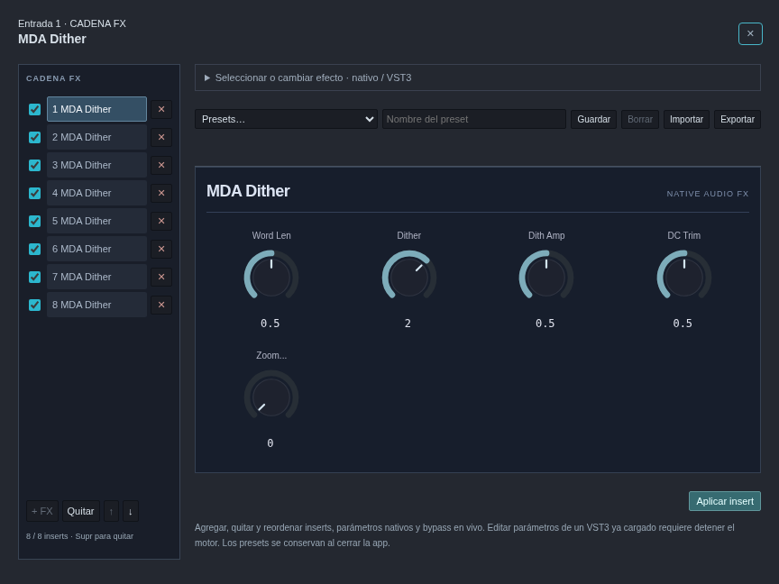
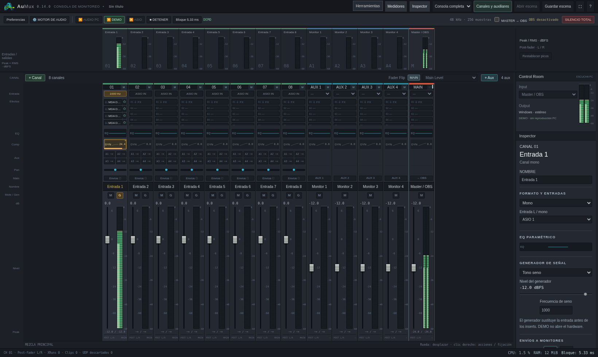
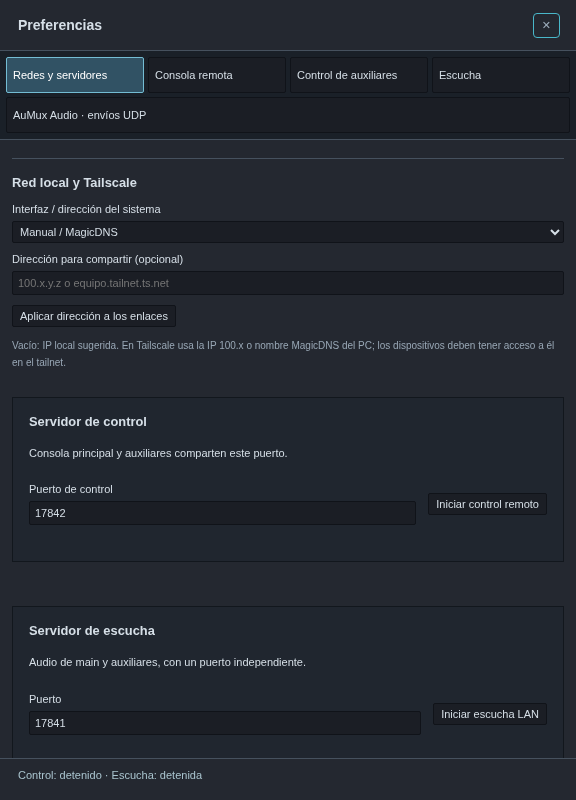
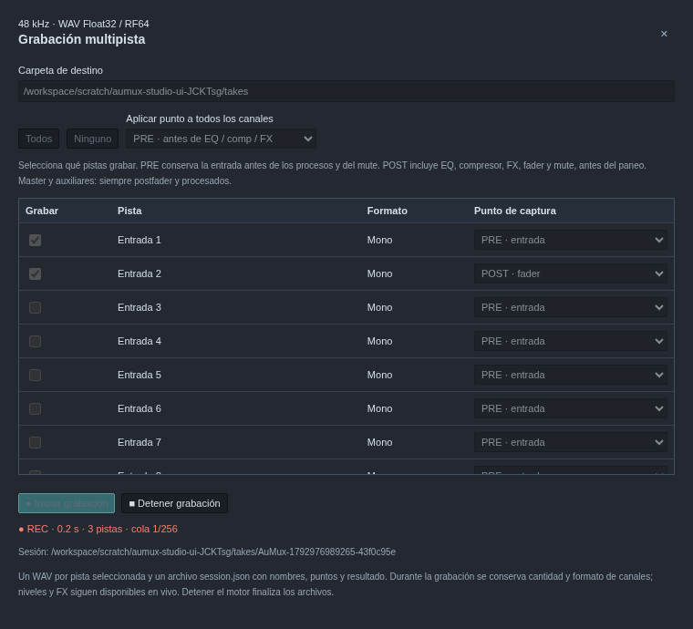

# AuMux 0.14.0 · ocho FX, controles y grabación multipista

[Descargar Windows x64](https://github.com/Lechuga-visual/aumux-consola-virtual/releases/download/v0.14.0/AuMux-0.14.0-Windows-x64.zip) ·
[Instalación](probar-en-windows.md) · [Galería](capturas.md)

## Ocho inserts y eliminación directa

Cada canal, auxiliar y master admite **ocho inserts**. El EQ y compresor propios
de la tira conservan sus accesos separados y no consumen inserts. En la consola,
el rack tiene scroll propio para conservar el recorrido del fader.

La ventana FX incluye **✕ por efecto** y **Quitar** para el seleccionado.
**Supr** elimina una vez por pulsación; se conserva el foco de la selección y
funciona también tras pulsar el encabezado del editor. Si estás escribiendo en
un campo de texto o número, Supr edita ese campo. Mantenerla presionada no borra
la cadena por repetición automática.

Se corrige la comparación de configuraciones entre ventanas: el orden de las
propiedades de un objeto no impide recibir una eliminación. Las ediciones de
parámetros que llegan tarde conservan la cadena actual y no recuperan inserts
eliminados.

## Clic derecho según el control

| Lugar | Acciones |
| --- | --- |
| Un insert FX | Abrir, activar/bypass, mover antes/después, **Eliminar FX** |
| Espacio vacío del rack | Añadir efecto o abrir navegador |
| EQ | Abrir, activar/bypass, restablecer |
| Compresor DYN | Abrir, activar/bypass, restablecer |
| Un envío auxiliar | Abrir envíos, silenciar/activar ese envío, PRE/POST |
| Pan | Centrar |
| Fader | Unidad a 0 dB o silenciar |
| Encabezado/fondo del canal | Renombrar, herramientas de tira, fijar, duplicar, **Eliminar canal** |

El menú sobre un FX no incluye eliminar el canal. Los campos editables conservan
su menú de texto. Los controles de mover/eliminar inserts mantienen el cambio
en vivo del motor implementado en 0.13.3.

## Compresor visible en la tira

DYN muestra la **curva estática de transferencia**, incluidos makeup y mezcla
paralela. Se ilumina en dorado al estar activo y queda gris en bypass. Un punto
indica parámetros distintos de los iniciales; activar/desactivar por sí solo no
cuenta como modificación. El indicador y número de **reducción de ganancia**
provienen del motor, no de una animación simulada. El tooltip distingue activo,
apagado, parámetros modificados y reducción en dB.

La curva es estática: ataque, release y sidechain afectan la reducción real y
pueden marcar ajustes modificados sin cambiar esa curva.

## Ventanas proporcionadas al monitor

Las ventanas nuevas solicitan como máximo **45 % del ancho y 60 % del alto** del
área disponible del monitor para FX y herramientas. Preferencias solicita
**30 % del ancho y hasta 80 % del alto**. Se mantienen límites adicionales para
no crear ventanas enormes en monitores de mucha resolución.

Estos son tamaños iniciales: puedes redimensionarlas. El navegador/sistema puede
imponer un tamaño mínimo o abrir una pestaña en móvil. Una ventana ya abierta
conserva el tamaño que le diste. Las preferencias reordenan sus categorías en
pantallas estrechas y los contenidos de FX tienen scroll.

## Primera grabación multipista

Abre **Herramientas → Grabación multipista**, con AUDIO PC, ASIO o DEMO ya
funcionando. En ASIO se capturan las entradas asignadas. AUDIO PC/DEMO conservan
su alcance actual: permiten probar los generadores; no añaden captura de
micrófonos del sistema.

1. Elige la carpeta **en el PC que ejecuta el motor**. Vacía usa
   `%USERPROFILE%\Music\AuMux` en Windows. La ruta manual debe ser absoluta.
2. Marca **Grabar** solo en las pistas que necesites. **Todos / Ninguno**
   facilita seleccionar canales, master y auxiliares.
3. En cada canal seleccionado, elige su punto de captura. El selector de arriba
   aplica un punto a todos los canales como atajo; cada fila se puede ajustar.
4. Pulsa **Iniciar grabación**. Para terminar la toma sin parar el audio, usa
   **Detener grabación**.

| Pista/punto | Qué se guarda |
| --- | --- |
| Canal PRE | Entrada asignada o generador, antes de EQ, compresor, FX, fader y mute |
| Canal POST | EQ, compresor, FX, fader y mute; **antes del paneo** |
| Master seleccionado | Siempre postfader, con todos sus procesos y el paneo de la mezcla |
| Auxiliar seleccionado | Siempre su salida postfader y procesada |

El POST de canal se toma antes del paneo para que una pista mono siga siendo una
pista mono útil aunque esté paneada a un lado. El paneo queda registrado en las
mezclas master/auxiliares. El master también es seleccionable; su punto no se
puede cambiar a PRE.

Cada toma crea una carpeta distinta con **un WAV por pista seleccionada**, a
**48 kHz y Float32**, mono o estéreo según la tira. El nombre incorpora su número,
nombre de canal y PRE/POST. Las pistas no seleccionadas no generan archivos. Se
usa RF64 automáticamente cuando un archivo supera el tamaño RIFF normal.

Los archivos comparten reloj e inicio. No se compensa automáticamente la latencia
que los plugins añadan a pistas POST o a los buses.

`session.json` conserva nombres, formato, selección, puntos, versión, muestras
por archivo y resultado de la toma. Los nombres de archivos corresponden al
inicio de la sesión. Esta base aún no incluye una línea de tiempo, edición de
tomas ni reproducción multipista dentro de AuMux.

Cerrar la ventana de grabación **no detiene la toma**. El indicador **REC** de la
consola permite volver a abrirla. Detener el motor o cerrar normalmente el
servicio finaliza los archivos. Durante la toma se conserva la cantidad y formato
mono/estéreo de canales y buses: finaliza la grabación para cambiarlos, sin que
sea necesario parar el motor. Niveles, EQ, compresor y cambios de cadena FX siguen
disponibles; el editor de parámetros de un VST3 activo conserva su restricción.

### Disco y continuidad

El callback solo copia las muestras seleccionadas a un conjunto preasignado de
buffers. Otro hilo escribe los WAV. La cola de disco está limitada a 256 bloques
de 256 muestras, unos 1,37 s a 48 kHz; **no añade ese retardo a la escucha**.

Las cabeceras se actualizan aproximadamente cada segundo y se finalizan al
terminar. Esto facilita recuperar el prefijo válido tras un cierre forzado del
proceso; no garantiza recuperar todo ante un corte de energía o fallo de disco.
Si el almacenamiento no alcanza o hay un error de escritura, la toma se marca
incompleta y se informa el error; el motor de audio sigue. Un loopback de prueba
no se puede iniciar durante una toma.

## Actualización de SoundCraft y validación

Se fijan DSP, host VST3 y audio I/O de SoundCraft al commit
[`cf0f4d2`](https://github.com/storytold/soundcraft/commit/cf0f4d2f6a2629b48a1dfbed858ac8c5f227bc42).
Se aprovechan compatibilidad de mensajes VST3, gestión de salida de módulos y
cabeceras WAV/RF64. [Revisión y alcance](soundcraft-engine-0.14.md).

Las pruebas verifican ocho inserts, Supr, botones individuales, aislamiento de
menús, curva/GR, tamaño solicitado de ventanas, grabación selectiva PRE/POST y
master post, archivos alineados, cierre/reapertura del panel durante la toma,
rechazo de cambios de formato y copia de grabación sin operaciones de heap Rust
en el callback. Se prueban audio, remotos y OBS en Linux. El paquete Windows se
compila de forma cruzada; siguen pendientes su ejecución nativa y la prueba con
hardware ASIO real.
