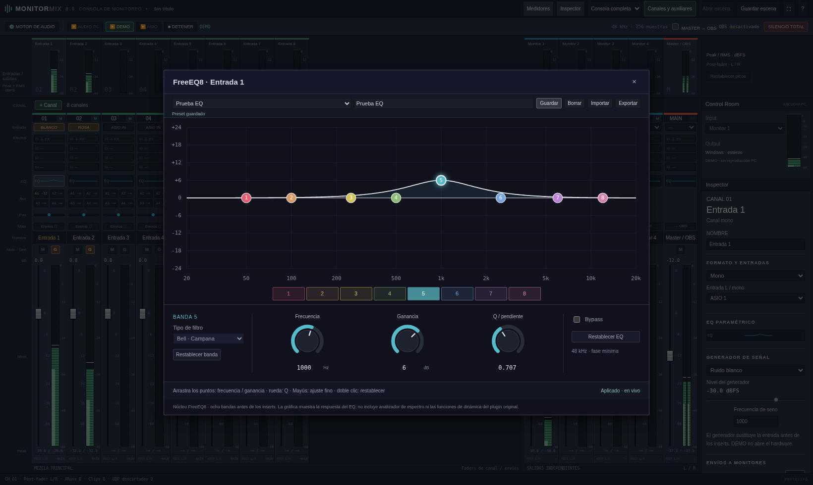
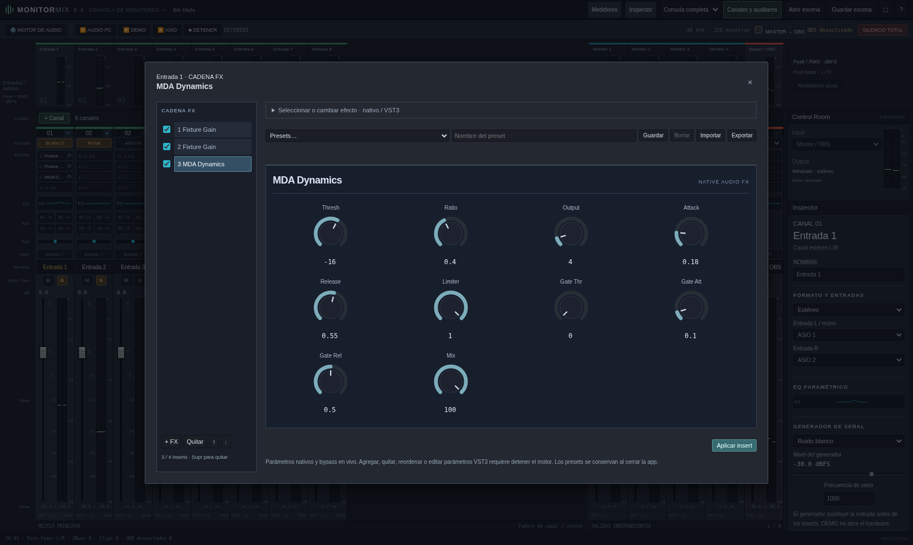
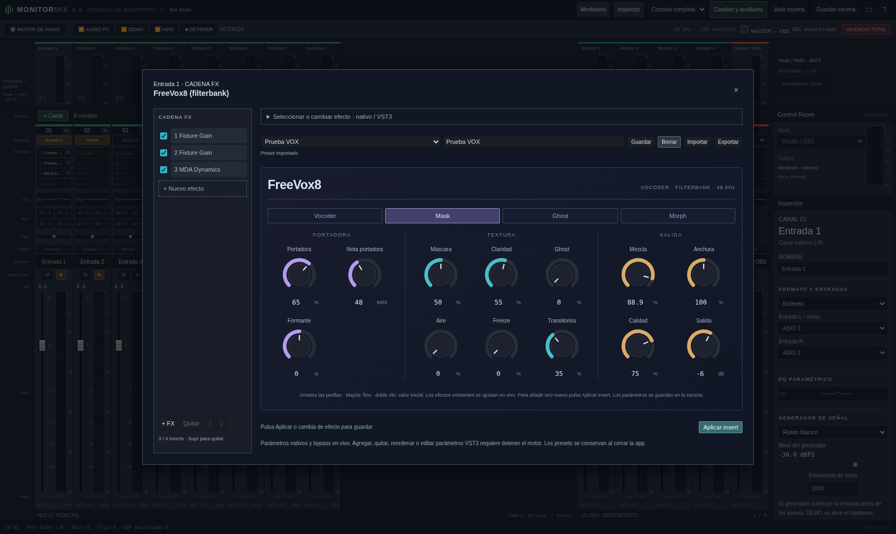
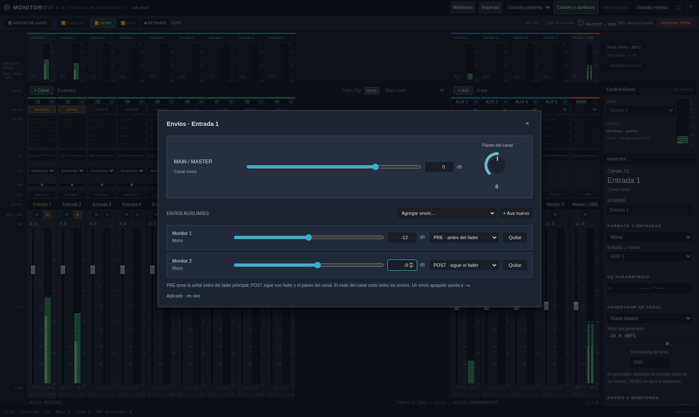

# Monitor Mix 0.6 · paneles de mezcla

Descarga [Windows x64](../dist/MonitorMix-0.6.0-Windows-x64.zip), extrae todo
y abre el ejecutable nuevo después de cerrar el anterior. La marca de la
consola debe indicar **0.6**. Trabajo a 48 kHz.

## Canales y auxiliares

**+ Canal** y **+ Aux**, sobre sus bancos, agregan una tira mono sin detener
el motor y desplazan la consola para mostrarla. El contador adyacente o
**Canales y auxiliares** abre las cantidades y formatos de las nuevas tiras.
Se admiten 1–64 canales y 0–32 auxiliares. Reducir quita las últimas tiras;
guarda una escena antes si quieres recuperarlas.

## EQ

Selecciona una de las ocho bandas por su punto o pestaña. Arrastra el punto
para frecuencia y ganancia; usa la rueda sobre él para Q. Las perillas se
arrastran verticalmente, Mayús hace ajuste fino y doble clic restablece el
valor. Los números permiten edición exacta. Para filtros de corte y pasa
banda, ganancia queda desactivada porque no interviene en ese filtro.

La curva representa la respuesta del EQ, no un espectro de la señal. Se
integra el núcleo de fase mínima de FreeEQ8, sin dinámica, matching o fase
lineal. EQ, bypass y presets funcionan en vivo.

## Cadena FX y MDA

Abre un insert y selecciona un efecto de la lista lateral. Las casillas
controlan bypass; **+ FX** añade otro efecto, **Quitar** o Supr lo elimina y
↑/↓ cambia su orden. Hay cuatro slots por canal, aux o master.

MDA usa perillas basadas en sus parámetros; FreeVox tiene un panel propio.
Los VST3 externos reciben un editor genérico con deslizador y valor por
parámetro. No se abre la interfaz propia del VST3. Agregar, quitar, reordenar
y editar parámetros VST3 requiere detener; los parámetros nativos existentes
pueden ajustarse con audio activo. Cambiar de efecto o cerrar conserva los
ajustes del editor; no hace falta cerrar la ventana para editar el siguiente.

## FreeVox8

Cuatro modos —Vocoder, Mask, Ghost y Morph— y perillas agrupadas en Portadora,
Textura y Salida. La nota de portadora es un número MIDI, sin entrada MIDI
externa. El panel controla el motor filterbank integrado.

## Presets

EQ, MDA, FreeVox y el editor genérico VST3 comparten biblioteca de presets por
efecto. **Inicial / predeterminado** recupera los valores iniciales; escribe
un nombre y pulsa **Guardar** para crear o reemplazar un preset de usuario.
El selector lo recupera. **Borrar**, **Importar** y **Exportar** gestionan los
presets JSON. No se incluyen bancos de fábrica inventados ni estados binarios
VST3. En Windows la biblioteca persiste en
`%LOCALAPPDATA%\MonitorMix\presets.json`, independientemente de la escena.
En Linux se usa `$XDG_DATA_HOME/MonitorMix` o `~/.local/share/MonitorMix`.
`MONITOR_MIX_DATA_DIR` permite redirigirla en pruebas.

## Envíos

**Envíos ↗**, en la tira de entrada, abre nivel principal, paneo y destinos
auxiliares. **Agregar envío** activa uno a −12 dB; luego ajusta su nivel y
PRE/POST. **Quitar** lo apaga a −∞. **+ Aux nuevo** crea un auxiliar y lo
incluye. Los auxiliares mono no siguen el paneo; los estéreo usan el paneo
del canal. No se ofrece paneo independiente por envío ni ruteo MIDI.

## Comprobaciones

Se verificaron 20 pruebas Rust, cambios de parámetros nativos con audio
medido sin reconstrucción ni trabajo de heap en el callback, persistencia y
validación de presets, e interacción real en Chromium: perillas, puntos,
selección de bandas, cadena, Supr, importación/exportación y envíos en vivo.
El ZIP incluye fuentes y licencias y se compila para Windows x64. La prueba
nativa de esta versión con WASAPI/ASIO y la MOTU requiere el PC de Windows.
