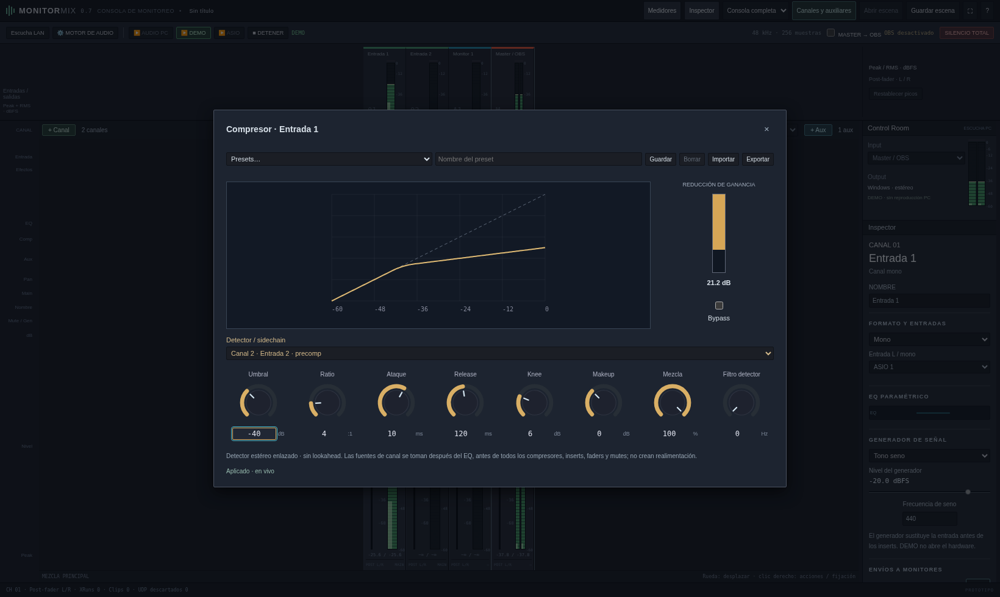
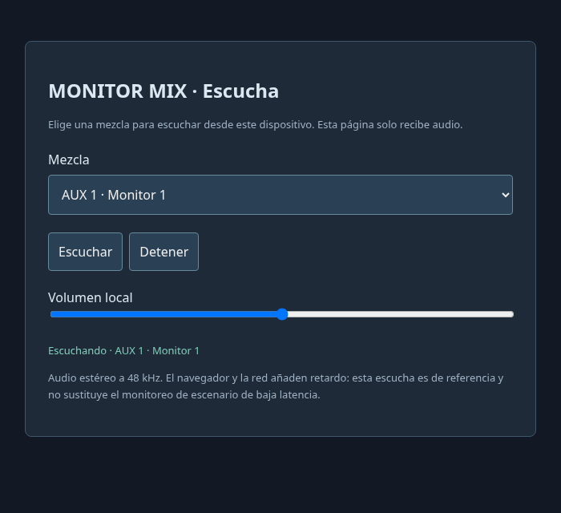

# Monitor Mix 0.7 · dinámica, superficie y escucha LAN

[Descargar Windows x64](../dist/MonitorMix-0.7.0-Windows-x64.zip). Extrae todo,
cierra la versión anterior y abre MonitorMix.exe. La consola debe indicar 0.7.
Sigue trabajando a 48 kHz; las funciones de EQ, FX y envíos de
[0.6](interfaz-0.6.md) se conservan.

## Superficie adaptativa

Con pocas tiras, canales, auxiliares y master se centran dentro de la superficie.
Al superar su ancho aparece desplazamiento horizontal; la rueda sobre el fondo
recorre las tiras. Los medidores superiores acompañan ese recorrido. El master
queda fijado a la derecha de forma predeterminada.

Clic derecho sobre una tira abre acciones propias: renombrar, EQ, compresor,
cadena FX, envíos, duplicar, eliminar y fijar a izquierda o derecha. **Desfijar**
devuelve la tira al banco desplazable. Las fijaciones se guardan en la escena.
Si se reduce mucho la ventana, se suspenden visualmente las fijaciones que no
caben para reservar al menos una tira desplazable; el master tiene prioridad.
Al ampliar se recuperan. Los campos conservan selección de texto y menú de
edición. Las etiquetas ya no se seleccionan al arrastrar.

Duplicar añade una copia al final; en un auxiliar, la copia no tiene salida
física ni envíos de entrada activos. Con audio en marcha se puede eliminar la
última tira; quitar una intermedia exige detener. Master no se duplica/elimina.

## Compresor nativo con sidechain

**DYN**, debajo del EQ de cada canal, aux o master, abre el panel. Empieza en
bypass. Desmarca **Bypass** y ajusta umbral, ratio, ataque, release, knee,
makeup, mezcla y filtro pasa altos del detector. Doble clic restablece una
perilla; el campo numérico permite valores exactos. La curva representa la
transferencia estática; **GR** muestra la reducción calculada por el motor.
La biblioteca de presets guarda parámetros, conservando la fuente de detector
y el estado de bypass de la tira al recuperar un preset.

El detector puede usar la señal interna, otro canal o una entrada física.
Las fuentes de canal se toman después del EQ y antes de todos los compresores,
inserts, faders y mutes. Un canal silenciado puede activar el sidechain; el
orden de las tiras no cambia el resultado ni introduce realimentación. Las
entradas físicas requieren el modo ASIO; en AUDIO PC/DEMO usa un canal con
generador para probarlo sin hardware.

La compresión enlaza ambas ramas estéreo por pico y no usa lookahead. Se
procesa después del EQ y antes de los inserts, también en buses. Parámetros,
fuente y bypass se ajustan en vivo. No añade un bloque de retardo al audio.
No reemplaza un limitador de seguridad de salida.

## Escucha por navegador en la red local

1. Inicia el motor con ASIO, AUDIO PC o DEMO y prepara señal y envíos.
2. Abre **Escucha LAN**; elige un puerto libre, por defecto **TCP 17841**,
   y pulsa **Iniciar escucha LAN**. El servidor comienza apagado en cada arranque.
3. Copia el enlace completo al teléfono o PC en la misma red. Incluye una
   clave de lectura. Si la IP sugerida no corresponde a esa red, reemplaza
   solo la IP por la dirección local correcta del PC.
4. Abre el enlace en un navegador moderno, elige MAIN o AUX y pulsa
   **Escuchar**. El volumen de esa página solo afecta a ese oyente.
5. **Detener escucha LAN** cierra la escucha para todos. Detener el motor deja
   el servidor disponible pero sin señal; SILENCIO TOTAL envía silencio.

Cada oyente elige un bus distinto sin cambiar el Control Room local ni OBS.
Hasta ocho oyentes simultáneos. Los auxiliares mono se entregan duplicados en
L/R. El audio se toma post-fader, mute y recorte de salida, a 48 kHz, estéreo
float32 sin compresión: aproximadamente 3,1 Mbit/s por oyente, más HTTP/TCP.
La página programa un búfer de unos 120 ms; se suma el retardo de red,
navegador y dispositivo. El retardo extremo a extremo no está calibrado y esta
escucha no sustituye las salidas locales de baja latencia.

El servidor LAN solo publica página, nombres y audio. La API de mezcla sigue
en loopback con su autorización propia. Este enlace aún no permite cambiar
faders ni crear mezclas personales. Windows puede pedir acceso a la red
privada; no se configuran reglas del firewall automáticamente. El puerto de
escucha es independiente del puente UDP de OBS y del control local.

## Validación

24 pruebas Rust cubren DSP, ruteo, cambios de grafo y callback sin heap.
Se prueban ratio/knee, recuperación, detector externo estéreo y sidechain
independiente del orden desde el primer bloque. La publicación LAN usa colas
acotadas con paquetes preasignados; su prueba verifica separación y saturación
sin asignación ni liberación de memoria en el callback.

La prueba de red mide PCM real simultáneo de main/aux, relación de niveles,
silencio, clave de lectura y ausencia de rutas de control. Chromium comprueba
centrado, fijación independiente, medidores sincronizados, menú, selección,
compresión con señal activa y reproducción web/cambio de bus. La validación
completa conserva las pruebas de FX nativos con sanitizadores y del receptor
con libobs real. El paquete se compila para Windows x64; la ejecución nativa
con WASAPI/ASIO y dispositivos de la red requiere la prueba local de Windows.
