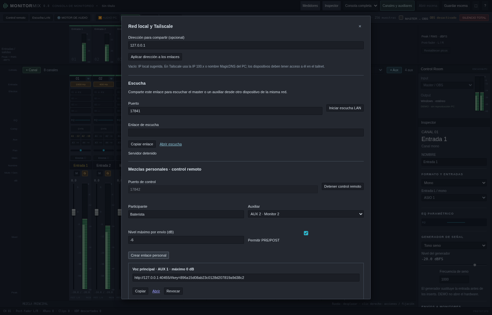
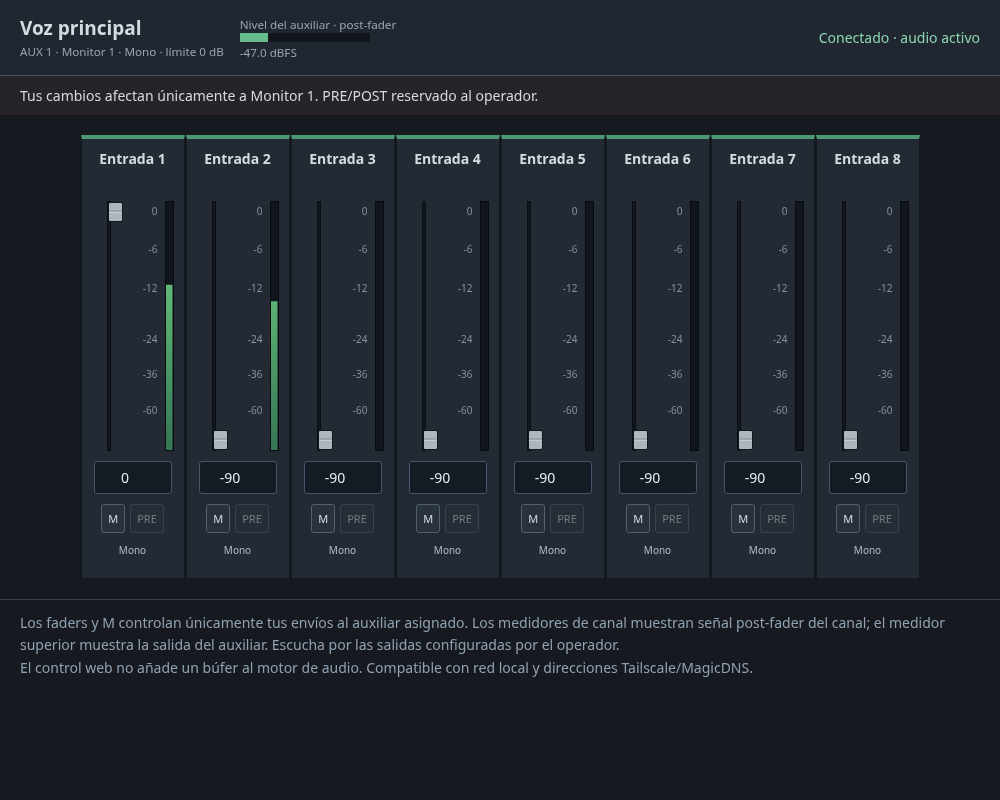
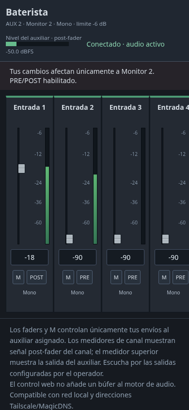

# Monitor Mix 0.8 · mezclas personales por web

[Descargar Windows x64](../dist/MonitorMix-0.8.0-Windows-x64.zip). Extrae todo,
cierra la versión anterior y abre el nuevo MonitorMix.exe: debe indicar 0.8.
Continúa a 48 kHz. No incorpora instrumentos virtuales.

## Preparar enlaces desde la consola del operador

1. Configura canales y auxiliares, envíos, nivel del auxiliar y salida física.
   Puedes probar con generadores en DEMO/AUDIO PC sin ASIO.
2. Abre **Control remoto**. El servidor está apagado al iniciar; pulsa
   **Iniciar control remoto**. Usa por defecto **TCP 17842**, independiente
   de la escucha de audio en TCP 17841 y del puente UDP de OBS.
3. Escribe el participante, elige **un auxiliar**, fija el nivel máximo que
   podrá asignar a cada envío (predeterminado 0 dB) y decide si permitir PRE/POST.
   Pulsa **Crear enlace personal** y entrega ese enlace completo al participante.
4. Puedes crear hasta 32 enlaces y revocarlos individualmente. Varios enlaces
   al mismo auxiliar comparten esa mezcla; asigna auxiliares distintos para
   mezclas independientes. El límite restringe cambios del participante, no
   reduce automáticamente niveles que haya fijado el operador.

El servidor valida auxiliar y permisos; el navegador no puede elegir otro bus
mediante una petición. El operador conserva nivel/mute de salida, salidas físicas,
main, ganancia/pan del canal, efectos, generadores y configuración del motor.

## Superficie del participante

Se muestran las tiras de entrada con nombre, formato, fader, nivel exacto,
medidor y **M** para silenciar solo ese envío. M conserva el nivel para
recuperarlo al desactivar. PRE/POST se muestra siempre y se puede cambiar
únicamente cuando el operador lo permite. Doble clic en el fader vuelve a
0 dB o al máximo autorizado si es menor. El campo numérico permite décimas.

Los canales se desplazan horizontalmente en pantallas pequeñas. Los medidores
de canal muestran pico del bloque procesado **post-fader del canal**, no el
nivel de cada envío. El medidor superior muestra el auxiliar post-fader de salida.
No consumen ni reinician los picos de la consola principal. El estado muestra
motor detenido, audio activo, error o silencio total.

Los cambios son por campo: dos usuarios en auxiliares diferentes no se pisan.
Si varios clientes cambian el mismo campo, prevalece el último cambio aceptado
por el servidor. La consola local recibe ajustes remotos y conserva los envíos
remotos al publicar cambios locales en otros controles. El mute por envío
aparece también como **M** en el inspector y la ventana de envíos del operador;
se guarda con la escena y no activa el mute global del canal.

Al perder conexión se deshabilitan controles y se descartan cambios pendientes;
al reconectar se recupera el estado del servidor, sin reproducir una cola antigua.
Un enlace revocado deja de controlar inmediatamente. Cargar una escena, cambiar
el número de canales/auxiliares o detener el servidor revoca todos los enlaces
para evitar que un índice cambiado termine controlando otra persona. Guarda
las mezclas en una escena; los enlaces y permisos no persisten al cerrar la app.

## Tailscale y MagicDNS

Ambos servidores escuchan por defecto en las interfaces IPv4 del PC, incluida
la interfaz de Tailscale. No necesitas exponer la consola de administración.

1. Conecta el PC y los dispositivos remotos a Tailscale y comprueba acceso entre
   ellos según las reglas del tailnet.
2. En **Dirección para compartir**, escribe la IP **100.x.y.z** del PC o su
   nombre MagicDNS, por ejemplo `estudio.nombre-tailnet.ts.net`. Es solo el host,
   sin `http://`, puerto ni ruta. Pulsa **Aplicar dirección a los enlaces**.
3. Copia los enlaces personales actualizados. La misma dirección se aplica al
   enlace de escucha si la inicias. Los puertos son configurables y deben estar
   permitidos por Windows y las reglas de Tailscale: 17842 para control y 17841
   para escucha, ambos TCP por defecto.
4. Con dirección vacía se vuelve a la IP local sugerida para usar la LAN.

Los enlaces usan HTTP directo dentro de la conexión de Tailscale; la app no
instala Tailscale, configura el tailnet ni implementa Tailscale Serve/Funnel.
No abras la consola local mediante un proxy para compartir estos controles.
Para comprobar si el enlace de Tailscale es directo o por relay, usa
`tailscale ping <equipo>` o `tailscale status`; un relay puede aumentar el retardo.
La escucha mantiene sus ocho oyentes simultáneos; control admite hasta 32 enlaces,
sin prometer carga/latencia medida para 32 usuarios activos con hardware real.

Las direcciones IPv6 se formatean correctamente en los enlaces. Los servidores
usan IPv4 por defecto: para una instalación exclusivamente IPv6 se requiere
iniciar con `MONITOR_REMOTE_BIND=::` y `MONITOR_LISTEN_HOST=::` y anunciar la IPv6
real en el campo de dirección. No se ha verificado esa configuración en Windows.

## Tiempo real y audio de escucha

El control web no transporta audio ni añade bloques/buffers al motor. Sus cambios
pasan por una cola acotada al hilo de control y se aplican mediante atómicos;
el procesamiento mantiene su transición habitual de un bloque. Peticiones de
control caducadas no se aplican tarde. El servidor no realiza red, bloqueos ni
serialización dentro del callback. El navegador agrupa el arrastre en cambios
cada 20 ms como máximo y consulta estado alrededor de cada 100 ms; el trayecto
de control y el de audio son independientes.

Escucha por la salida física asignada al auxiliar para monitoreo local. Si quieres
comprobar audio desde el navegador, el operador puede compartir además el enlace
**Escucha LAN** y allí elegir el auxiliar correspondiente. El enlace de escucha
permite oír cualquier bus, por lo que se comparte por separado del enlace de
control. Ese transporte de audio conserva el búfer inicial de unos 120 ms más
red/navegador/dispositivo; optimizarlo sigue siendo una prioridad. Esta versión
no reduce esa latencia ni promete monitoreo de escenario por Internet/Tailscale.

## Validación

29 pruebas Rust: permisos y revocación, límites, mezcla concurrente, merge con la
consola, mute/restauración de audio por envío y callback sin asignación/liberación
de memoria, además de las pruebas previas de DSP, VST3 y cambios de grafo.
La integración HTTP mide PCM real de main y dos auxiliares mientras aplica
cambios de usuarios separados; verifica que main y los otros envíos no cambian,
permisos, revocación y direcciones Tailscale/MagicDNS. Chromium cubre administración,
dos sesiones, vista móvil, reconexión, mutes, PRE/POST, faders y conflictos locales.

La prueba de control en loopback mide el tiempo de ida y confirmación HTTP;
no es una medición de latencia de audio ni de Tailscale. La compilación Windows
x64 y el paquete se verifican aquí; la ejecución con Windows e interfaces ASIO y la conexión
entre dispositivos reales del tailnet quedan para la prueba local.
