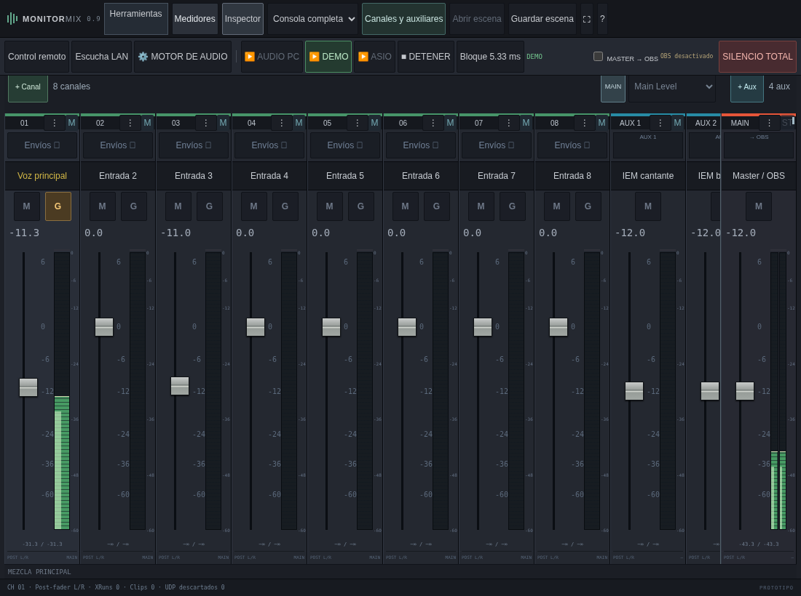
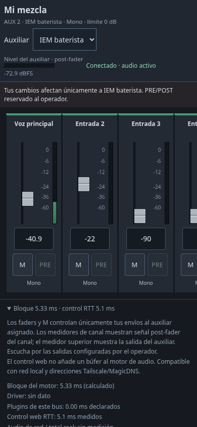
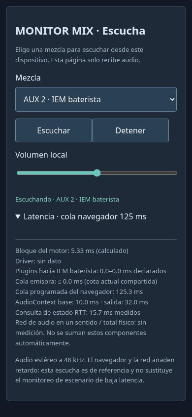
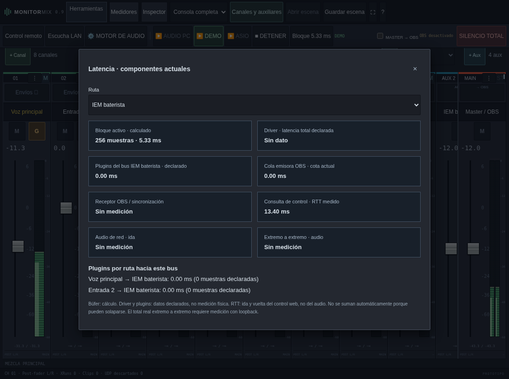
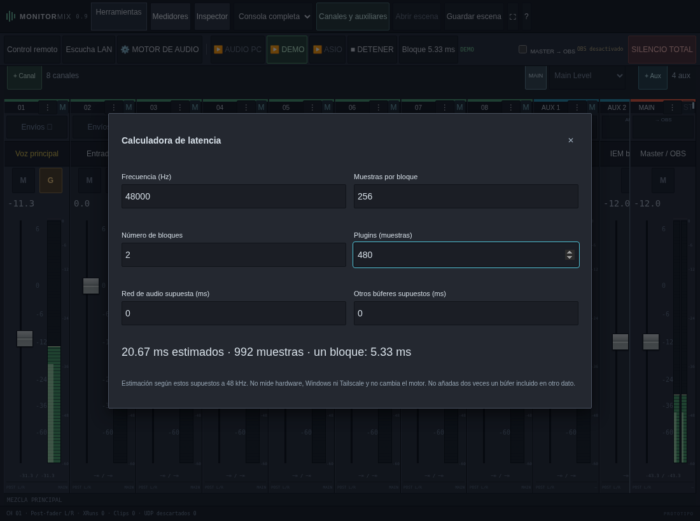

# Monitor Mix 0.9 · touch, enlaces unificados y consola remota

[Descargar Windows x64](../dist/MonitorMix-0.9.0-Windows-x64.zip). Extrae todo,
cierra el proceso anterior y abre el nuevo MonitorMix.exe. La marca debe indicar
**0.9**. Continúa trabajando a **48 kHz**.

## Touch en PC, tablet y teléfono

**Herramientas → Interfaz touch** ofrece Automática, Activada y Desactivada.
Automática detecta entrada táctil o pantalla estrecha; la preferencia se guarda
en cada navegador. Puedes activarla en una pantalla touch de Windows con mouse
conectado, o desactivarla para volver a la consola compacta habitual.

Touch amplía tiras, botones y áreas de agarre; fija la consola al alto de pantalla
y bloquea el desplazamiento vertical de la página. El arrastre sobre un fader
no hace scroll; las tiras y barras superiores se recorren horizontalmente desde
el fondo. Los diálogos e inspector mantienen su propio desplazamiento vertical.

En pantallas de menor altura se ocultan módulos para conservar recorrido del
fader. El botón **⋮** de cada tira da acceso a EQ, compresor, FX, envíos y acciones.
**Inspector** abre un panel superpuesto para editar el canal seleccionado. Se
admiten orientación vertical y horizontal; el mezclador conserva el master fijado.

## Mezclas personales y acceso único

Abre **Control remoto** para iniciar el servidor, por defecto **TCP 17842**.
La sección **Enlace único de mezclas auxiliares** ofrece:

| Acceso | Qué permite |
| --- | --- |
| Solo enlaces personales | La clave de cada enlace autoriza únicamente su auxiliar, como en 0.8. |
| Contraseña compartida | Un único enlace sin clave en la URL; después de entrar permite elegir un auxiliar. |
| Abierto sin contraseña | El mismo enlace genérico con selector de auxiliar y acceso inmediato. |

Define máximo de nivel y permiso PRE/POST para el acceso compartido y pulsa
**Aplicar acceso de mezclas**. Para contraseña debes escribirla al aplicar;
no se recupera ni se muestra la anterior. Copia el campo **Enlace único**.
El selector muestra los nombres reales de los auxiliares y las tiras conservan
los nombres/formato asignados en la consola principal, también al renombrarlos.

Este acceso cambia **envíos a auxiliares**, no el main, efectos ni salidas físicas.
Los enlaces personales siguen disponibles con sus propios permisos hasta que
los revoques. Cambiar el auxiliar desde la página no arrastra cambios pendientes
a otra mezcla. Varias personas que elijan el mismo auxiliar comparten sus ajustes;
usa auxiliares distintos para mezclas independientes.

Las páginas de mezcla ajustan su disposición según teléfono, tablet o escritorio.
Faders y botones tienen áreas táctiles mayores; no hay scroll vertical de la página.
El pie **Bloque / control RTT** despliega los componentes de latencia y la ayuda.
Mute conserva el nivel del envío y PRE/POST respeta el permiso del operador.

## Escucha genérica o protegida

La escucha usa su servidor separado, por defecto **TCP 17841**. En **Acceso a
escucha** puedes elegir enlace con clave, enlace único con contraseña o enlace
abierto sin contraseña. Aplica el modo e inicia la escucha; el enlace mostrado
se actualiza al formato correspondiente. En el enlace genérico no hay token en
la URL. El oyente elige main o cualquier auxiliar con su nombre actual, pulsa
**Escuchar** y ajusta su volumen local.

Al pasar de enlace con clave a contraseña, los enlaces de escucha anteriores con
clave dejan de autorizar el acceso. Cambiar contraseña revoca las sesiones de
escucha existentes; una conexión sin autorización se cierra. Detener el servidor
corta las escuchas. Las contraseñas de escucha, mezclas y consola son independientes.

La interfaz móvil presenta controles grandes y rango de volumen apto para touch.
El detalle de latencia muestra la cola programada de Web Audio y la latencia de
base/salida cuando el navegador la informa. El transporte sigue siendo PCM
estéreo float32 a 48 kHz con ocho oyentes; su búfer inicial de unos 120 ms no se
ha reducido en esta versión. Red, navegador y dispositivo añaden más retardo.

## Consola principal remota

En **Consola principal remota · acceso de operador**, elige Deshabilitado,
Con contraseña o Abierto sin contraseña. Aplica y copia el enlace de consola.
Usa el servidor de control de 17842, con un permiso independiente del de mezclas.

Abre la misma superficie de la consola, con detección touch, faders, main,
auxiliares, nombres, procesadores, escenas y controles del motor. Los cambios se
aplican en el PC que ejecuta Monitor Mix. El arrastre publica durante el
movimiento; los ajustes intermedios se agrupan para que una conexión lenta no
acumule una cola de posiciones antiguas del fader. No es una retransmisión del escritorio.
Los VST3 se buscan y procesan en ese PC; abrir/guardar archivos de escena usa el
navegador desde el que se controla.

La consola local y las remotas sincronizan el estado. Al cambiar campos distintos
se conservan ambos ajustes; para un mismo campo prevalece el último cambio aceptado.
Si otra consola cambia la estructura, se recupera la estructura del servidor;
no se aplican ajustes pendientes a índices que podrían representar otra tira.
Deshabilitar este acceso o cambiar su contraseña revoca las sesiones del operador.
El acceso de auxiliares no permite consultar ni llamar a esta API de consola.

## Elegir tarjeta de red, IP local o Tailscale

El selector **Interfaz / dirección del sistema** enumera nombres y direcciones
del PC. Selecciona la IPv4 que quieras y pulsa **Aplicar dirección a los enlaces**.
Las IP 100.x y adaptadores con nombre Tailscale se identifican como candidatos;
una dirección 100.x también puede pertenecer a otra red CGNAT. Para MagicDNS,
selecciona Manual y escribe el nombre. Se actualizan los enlaces de escucha,
mezclas y consola. Vacío recupera la sugerencia local; loopback sirve solo en el PC.

Esta selección modifica la dirección anunciada, no limita el servidor a una tarjeta.
Por defecto recibe por todas las interfaces IPv4, incluida Tailscale. Los dispositivos
necesitan acceso a esos puertos según Windows y las reglas del tailnet. La IPv6 se
muestra pero requiere configurar escucha IPv6 y escribir la dirección manualmente,
como se detalla en [0.8](interfaz-0.8.md). No se configura Tailscale automáticamente.

Los accesos empiezan con enlaces personales/clave y consola remota deshabilitada
al abrir la app. Los permisos, contraseñas y enlaces no se guardan en la escena ni
persisten al cerrar el proceso. Las contraseñas se derivan con PBKDF2-HMAC-SHA256
y sal aleatoria; los inicios de sesión usan cookies HttpOnly/SameSite con caducidad
de 12 horas y límites de intentos. La app sirve HTTP; en LAN no aporta TLS y en
Tailscale el transporte lo cifra el túnel. El modo abierto concede acceso a quien
pueda alcanzar el enlace, conforme a la opción elegida por el operador.

## Latencia actual y calculadora

La barra de la consola indica **Bloque N ms**. Pulsa ese indicador o
**Herramientas → Latencia y diagnóstico** para elegir una salida y ver:

- Bloque activo en muestras y milisegundos: cálculo con el tamaño real del stream.
- Latencia total declarada por RtAudio/driver, cuando la informa. No es una medida física.
- Latencia declarada de plugins del bus y de cada ruta canal → bus, sin compensación.
- Cota actual de la cola emisora de OBS; receptor/sincronía sin medición.
- RTT medido de la consulta de control web. No representa latencia del audio.
- Audio de red en un sentido y extremo a extremo: **Sin medición**.

Mezclas remotas muestran bloque, driver, plugins del bus y RTT del control.
Escucha añade cola emisora compartida, cola actual del navegador y valores de
AudioContext disponibles. La información del navegador se actualiza al reproducir
y durante la escucha. No se suman automáticamente componentes que podrían solaparse;
ni 256 muestras ni un RTT dividido por dos sustituyen una medición de audio.

**Herramientas → Calculadora de latencia** estima milisegundos/muestras a 48 kHz
según bloque, cantidad de bloques, muestras de plugins, red y otros búferes que
ingreses. No cambia el motor ni mide hardware. Por ejemplo, dos bloques de 256
muestras y 480 muestras de plugins dan aproximadamente 20,67 ms bajo esos supuestos.

El menú reserva futuras herramientas de detección de acoples, cancelación de
fase y osciloscopio. Esas herramientas todavía no realizan análisis de señal.

## Validación y límites

32 pruebas Rust cubren motor sin heap en callback, permisos, sesiones/revocación,
merge entre operadores y cálculo de componentes. La integración verifica audio
real hacia OBS, separación main/aux, claves y accesos unificados, contraseñas de
roles independientes, nombres, enumeración de interfaces y consola remota.

Chromium comprueba los flujos anteriores y gestos táctiles reales mediante CDP:
arrastre del fader sin scroll vertical, orientación vertical/horizontal, modo
touch en PC, vista móvil/tablet, inspector, calculadora, latencia y escucha.
El paquete se compila para Windows x64. No se ejecutó esta versión nativamente
en Windows ni se midió audio físico o un tailnet real; quedan la prueba local,
latencia real de la MOTU y sesiones largas. Optimizar la escucha de red sigue
siendo una prioridad de [la hoja de ruta](hoja-de-ruta.md).
