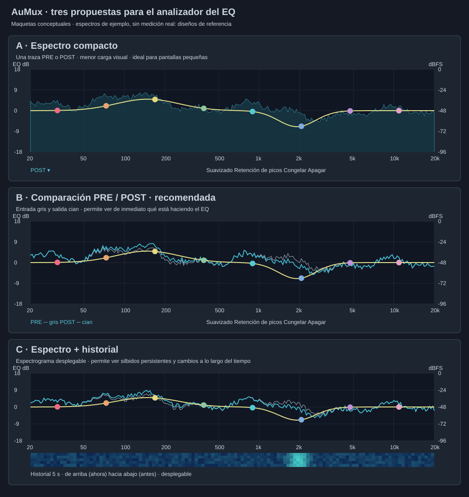

# Tres propuestas para el analizador de FreeEQ8

**Maquetas conceptuales originales; los espectros son ilustrativos.**
Las tres vistas ya están disponibles en [AuMux 0.14.1](../interfaz-0.14.1.md):
A inicialmente y B/C desde el menú contextual del gráfico. La guía enlazada
incluye capturas reales y describe el alcance de la implementación.

| Propuesta | Presentación | Ventaja | Coste / espacio |
| --- | --- | --- | --- |
| A · Compacto | Una traza con selector PRE o POST; curva del EQ siempre encima | Fácil de leer en ventanas pequeñas | Una traza analizada; ocupa la gráfica existente |
| B · Comparación, recomendada | PRE en gris y POST en cian, con opacidad y controles para ocultar cada traza | Permite comparar la señal inmediatamente antes y después del EQ | Dos trazas analizadas; mantiene el tamaño de la gráfica |
| C · Con historial | Comparación más espectrograma desplegable de los últimos segundos | Ayuda a observar resonancias persistentes y cambios en el tiempo | Más memoria y dibujo; el historial usa espacio adicional cuando se abre |

Las tres tendrían escala de frecuencia logarítmica de 20 Hz a 20 kHz, suavizado,
retención de picos, congelación y botón de apagado. La respuesta del filtro usa
**dB**; el espectro usa su propia escala **dBFS**, sin confundirlas.

## Audio en tiempo real

El diseño consiste en copiar las muestras inmediatamente antes/después del EQ a buffers
preasignados y hacer FFT en un hilo separado, nunca en el callback. Solo se
analizarían las tiras solicitadas por editores abiertos, compartiendo el análisis
entre ventanas que observan la misma tira. Si el análisis se atrasa, se descartan
actualizaciones visuales; el audio no espera al analizador.

A 48 kHz, ventanas FFT de 2048 / 4096 / 8192 muestras observan aproximadamente
42,7 / 85,3 / 170,7 ms y separan bins de 23,4 / 11,7 / 5,86 Hz. Es tiempo de
observación de la imagen, **no retardo añadido a la señal de audio**. La implementación inicial usa 4096 muestras y consulta la imagen aproximadamente
cada 80 ms, con un máximo de ocho tiras analizadas a la vez. La transferencia al navegador envía
resultados espectrales, no una nueva escucha de audio.

El análisis estéreo combina potencias de L/R para su vista conjunta,
sin sumar las ondas y ocultar señales por cancelación. La calibración de amplitud,
ventana FFT y escala dBFS se comprueba con tonos de nivel conocido y pruebas de polaridad;
no se usan gráficos simulados en la aplicación.
