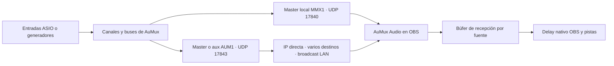

# Master de AuMux hacia OBS

El receptor es un plugin **de fuente de audio de OBS**; no es un filtro VST.
No necesita REAPER, ASIO dentro de OBS ni cable virtual.

Desde 0.12 el nombre visible de la fuente es **AuMux Audio**. Se conservan la
DLL `monitor-mix-receiver.dll` y el identificador interno `monitor_mix_receiver`
para que las escenas existentes sigan cargando.

El puente **MASTER → OBS** conserva su envío local post-inserts/post-fader.
Los nuevos flujos se configuran en **Preferencias → AuMux Audio · envíos UDP**.
Cada uno selecciona un bus, un identificador ASCII único y hasta ocho destinos
IPv4/MagicDNS, con puerto e interfaz local de salida. Se admiten hasta ocho
flujos activos. El audio es PCM float32 estéreo a 48 kHz, sin códec con pérdida;
los buses mono llegan duplicados a L/R.

Para broadcast indica la dirección de difusión de la subred y la IPv4 de salida
adecuada. Los receptores escuchan en su puerto y filtran por identificador.
En Tailscale usa envíos directos a las IP 100.x o nombres MagicDNS; el broadcast
no cruza la tailnet. Este transporte UDP tiene configuración y permisos de red
propios: las contraseñas de las interfaces web no se aplican a estos datagramas.

Varias fuentes OBS pueden compartir el mismo socket si usan exactamente la misma
IPv4 de escucha y puerto. Cada fuente filtra su flujo y mantiene búfer, delay y
modo de canales independientes. Con dos emisores del mismo identificador se
conserva el primero activo y se cuentan las colisiones; usa nombres únicos o
el filtro opcional de IPv4 del emisor.

En las propiedades pulsa **Configurar AuMux Audio…** para abrir el editor.
El preset **Local OBS** usa `127.0.0.1:17840`, flujo `AUMUX-MAIN`, búfer 0 ms.
**LAN / Tailscale** prepara `0.0.0.0:17843` y búfer 8 ms: revisa el identificador
y pulsa Aplicar. El delay es el mismo desplazamiento de sincronización de OBS;
los cambios desde sus controles nativos se reflejan en el editor. Los valores
negativos conservan el comportamiento nativo de OBS, sin prometer adelantar
una señal que todavía no ha llegado.

El panel muestra Peak/RMS antes del fader de OBS, estado, emisor, datagramas,
tardíos, duplicados, muestras sustituidas por silencio y cola actual. El peak
cae 20 dB en 400 ms y el RMS usa una integración de 300 ms. Ninguno de los
valores de búfer, cola o delay se presenta como latencia física total.

Protocolo y validación: [AuMux Audio 0.12](interfaz-0.12.md).

## La fuente no aparecía en 0.2

El instalador anterior copiaba a `%APPDATA%`, pero OBS Windows normal busca
plugins externos en `%PROGRAMDATA%\obs-studio\plugins`. El código de OBS que
establece esta ruta es `AddExtraModulePaths` de `frontend/widgets/OBSBasic.cpp`.
Ejecutar aquel instalador como administrador no corregía el destino.

En 0.3, cierra OBS y ejecuta el nuevo `Instalar-receptor-OBS.cmd` como administrador.
Abre OBS x64 32.1 o posterior (incluido 32.2.2), agrega la fuente
**AuMux Audio** y reutiliza esa misma fuente en otras escenas.
Varias fuentes de esta versión comparten el puerto mediante un receptor común. Activa MASTER → OBS, inicia DEMO,
AUDIO PC o ASIO y genera señal. No es necesario activar Escucha PC para transmitir.

**OBS recibe** se enciende por una respuesta del receptor después de entregar
un paquete válido a libobs; caduca si deja de recibir confirmaciones durante
1.5 segundos. No basta con que el envío UDP tenga éxito. La confirmación no
comprueba que la fuente esté audible en las pistas finales: revisa mute, fader,
escena y asignación de pistas en OBS. Con AUDIO PC evita duplicar el monitoreo.

`Diagnosticar-OBS.cmd` muestra la ruta instalada, hash y líneas del último
registro relacionadas con la carga del plugin. No modifica archivos. Si falla
la carga, copia esas líneas: permiten distinguir ruta, versión, modo seguro o
carga de DLL. La compatibilidad de archivos se ha compilado para OBS 32.1; aquí
se prueba la entrega de audio contra libobs en Linux, no OBS Windows nativo.

## Latencia y calidad del puente local

El callback de audio solo copia a una cola acotada; el socket trabaja en otro
hilo. Los datagramas llevan hasta 256 frames (5.33 ms a 48 kHz), o menos si el
bloque del dispositivo es menor. El trabajador revisa la cola cada 2 ms.
La cola se redujo de 128 a 8 paquetes; si se llena, se descarta el paquete más
antiguo para priorizar señal reciente. El contador UDP informa descartes o
errores de envío. No hay espera para llenar un paquete de 256 frames.

Esos valores describen el transporte, **no una latencia total medida**. Se suman
el buffer del dispositivo, los efectos y el buffering de OBS. Los VST3 pueden
añadir latencia; todavía no hay compensación automática. El motor recorta las
salidas a ±1 antes de transmitir; evita sobrecargar el master, pues ese recorte
no sustituye un limitador. No se aplica un códec con pérdida.
