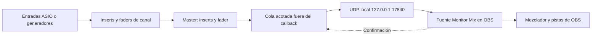

# Master de AuMux hacia OBS

El receptor es un plugin **de fuente de audio de OBS**; no es un filtro VST.
No necesita REAPER, ASIO dentro de OBS ni cable virtual.

Desde 0.11 la app se llama AuMux. La DLL `monitor-mix-receiver.dll`, el ID
de fuente, el protocolo UDP y el nombre **Monitor Mix — master local** permanecen
compatibles para conservar las escenas y las instalaciones existentes.

Envía únicamente el master post-inserts/post-fader, en estéreo float32 sin
compresión, a la frecuencia del motor. OBS adapta ese audio a su mezclador si
usa otra frecuencia. Conviene usar 48 kHz en ambos para evitar conversión.
Los auxiliares siguen siendo mezclas separadas para monitoreo; no se suman al
master ni se exponen como fuentes independientes.

## La fuente no aparecía en 0.2

El instalador anterior copiaba a `%APPDATA%`, pero OBS Windows normal busca
plugins externos en `%PROGRAMDATA%\obs-studio\plugins`. El código de OBS que
establece esta ruta es `AddExtraModulePaths` de `frontend/widgets/OBSBasic.cpp`.
Ejecutar aquel instalador como administrador no corregía el destino.

En 0.3, cierra OBS y ejecuta el nuevo `Instalar-receptor-OBS.cmd` como administrador.
Abre OBS x64 32.1 o posterior (incluido 32.2.2), agrega la fuente
**Monitor Mix — master local** y reutiliza esa misma fuente en otras escenas.
Solo una instancia puede ocupar el puerto. Activa MASTER → OBS, inicia DEMO,
AUDIO PC o ASIO y genera señal. No es necesario activar Escucha PC para transmitir.

**OBS recibe** se enciende por una respuesta del receptor después de entregar
un paquete válido a libobs; caduca si deja de recibir confirmaciones durante
1.5 segundos. No basta con que el envío UDP tenga éxito. La confirmación no
comprueba que la fuente esté audible en las pistas finales: revisa mute, fader,
escena y asignación de pistas en OBS. Con AUDIO PC evita duplicar el monitoreo.

`Diagnosticar-OBS.cmd` muestra la ruta instalada, hash y líneas del último
registro relacionadas con la carga del plugin. No modifica archivos. Si falla
la carga, copia esas líneas: permiten distinguir ruta, versión, modo seguro o
carga de DLL. La compatibilidad de archivos se ha compilado para OBS 32.1; aquí
se prueba la entrega de audio contra libobs en Linux, no OBS Windows nativo.

## Latencia y calidad

El callback de audio solo copia a una cola acotada; el socket trabaja en otro
hilo. Los datagramas llevan hasta 256 frames (5.33 ms a 48 kHz), o menos si el
bloque del dispositivo es menor. El trabajador revisa la cola cada 2 ms.
La cola se redujo de 128 a 8 paquetes; si se llena, se descarta el paquete más
antiguo para priorizar señal reciente. El contador UDP informa descartes o
errores de envío. No hay espera para llenar un paquete de 256 frames.

Esos valores describen el transporte, **no una latencia total medida**. Se suman
el buffer del dispositivo, los efectos y el buffering de OBS. Los VST3 pueden
añadir latencia; todavía no hay compensación automática. El motor recorta las
salidas a ±1 antes de transmitir; evita sobrecargar el master, pues ese recorte
no sustituye un limitador. No se aplica un códec con pérdida.

## ¿Cambiarlo por ReaStream?

ReaStream se distribuye gratis dentro de [ReaPlugs](https://www.reaper.fm/reaplugs/).
La edición ReaPlugs para Windows es VST2; OBS puede alojar filtros VST2, mientras
que AuMux actualmente aloja VST3. Por eso poner ReaStream en OBS no basta:
también hace falta un emisor compatible. No se puede insertarlo directamente
en nuestra cadena VST3 ni reemplazar el DLL de fuente por el DLL de ReaStream.

Una ruta alternativa con software existente es enviar desde un host que admita
ReaStream VST2 (por ejemplo, REAPER) y recibir con ReaStream en un filtro VST2 de
una fuente de audio activa en OBS, con identificador coincidente. Eso añade otro
host y exige conectar primero el master de AuMux a ese host; no simplifica
esta instalación concreta. REAPER tiene su propia licencia, separada de ReaPlugs.

Una salida nativa compatible con ReaStream permitiría eliminar ese host emisor,
pero necesita implementar el protocolo y probar paquetes, canales, frecuencias y
reconexión contra el receptor real. **0.3 no transmite ReaStream** ni afirma esa
interoperabilidad. Se conserva el puente propio corregido para poder probarlo
ahora, sin añadir otra dependencia ni prometer una latencia sin medir.
